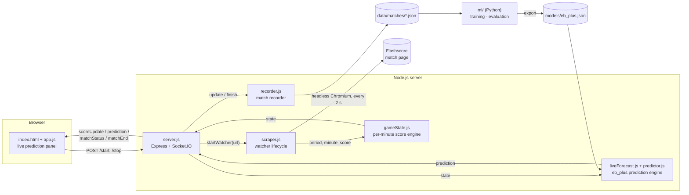
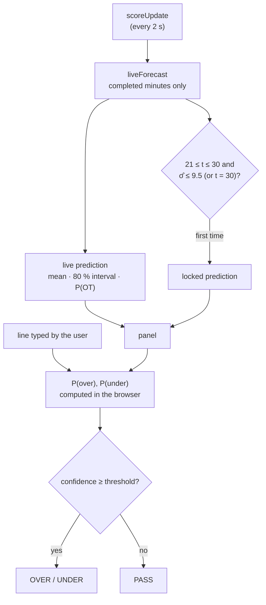

# BasketScrape

Real-time basketball analytics for live Flashscore matches. A headless Chromium session reads the scoreboard every two seconds, converts the cumulative score into **points per minute**, and predicts the **full-time total** live with a model trained and validated on 2873 EuroLeague and EuroCup games. The panel shows the prediction with a calibrated 80 % interval, locks it in the third quarter, and turns a bookmaker line into an over/under probability.

> **Scope:** FIBA format only (4 × 10-minute quarters, 5-minute overtimes). NBA (12-minute quarters) and NCAA (20-minute halves) are not supported yet.

---

## Contents

- [Architecture](#architecture)
- [Quick start](#quick-start)
- [Configuration](#configuration)
- [Prediction panel](#prediction-panel)
- [Machine learning](#machine-learning)
- [Testing](#testing)
- [Deployment](#deployment)
- [Project structure](#project-structure)
- [Documentation](#documentation)

---

## Architecture



| Component | Responsibility |
|---|---|
| `src/server.js` | HTTP API, Socket.IO broadcast, single active watcher, snapshot replay for late-joining tabs |
| `src/scraper.js` | Browser lifecycle: wait for tip-off → main loop → finish. Crash recovery and stale-page reload |
| `src/parse.js` | Pure parsers for period, minute, score and match status text; Flashscore URL allow-list |
| `src/gameState.js` | Converts cumulative scores into per-minute points (baseline, overwrites, overtime, score corrections) |
| `src/recorder.js` | Persists each match as minute-level cumulative scores for model training |
| `src/predictor.js` | JavaScript port of the `eb_plus` model; identical to Python on 200 exported cases. Also served to the browser |
| `src/liveForecast.js` | Per-match forecast: completed-minute inputs, history, lock at the decision minute, league gate |
| `src/demo.js` | Replays a finished game from the dataset instead of scraping (`DEMO_GAME`) |
| `public/` | Prediction panel: score, full-time total forecast, over/under decision, chart, minute grid |
| `ml/` | Python package: features, models, time-ordered validation, prediction-minute selection |

---

## Quick start

Requires **Node.js ≥ 18**.

```bash
npm install
npm start            # http://localhost:3010
```

1. Paste a Flashscore **EuroLeague** or **EuroCup** match URL and press **Start**.
2. If the match has not started yet, the server keeps checking for tip-off in the background.
3. The panel updates live. Type the bookmaker's line to get the over/under probability.
4. **Stop** ends the session, including while it is still waiting for tip-off.

Other leagues are still tracked and recorded, but the panel shows no prediction: the model has only been validated on EuroLeague and EuroCup.

**Demo without Flashscore:** `DEMO_GAME=E2025-013 DEMO_SPEED=1500 npm start` (or `DEMO_GAME=random`), then start with any Flashscore URL. A finished game from `ml/datasets/euroleague` is replayed minute by minute.

### Multiple instances (Windows)

```bat
kurulum.bat
```

Creates sibling copies `basketscrape-3020`, `-3030`, `-3040` and `-3050`, installs dependencies in each, and writes a `start.bat` that sets `PORT` for that copy.

---

## Configuration

| Variable | Default | Description |
|---|---|---|
| `PORT` | `3010` | HTTP port |
| `PUPPETEER_EXECUTABLE_PATH` | *(bundled Chrome)* | Use a system Chromium (required on Railway/Nix) |
| `DATA_DIR` | `data/matches` | Where match recordings are written |
| `RECORD_MATCHES` | `1` | Set to `0` to disable recording |
| `MODEL_PATH` | `models/eb_plus.json` | Prediction model exported by `python -m basketml export` |
| `DEMO_GAME` | *(off)* | Replay a dataset game (`E2025-013`, `random`) instead of scraping |
| `DEMO_SPEED` | `1500` | Demo: milliseconds per game minute |

Only Flashscore URLs are accepted (`flashscore.com`, `flashscore.com.tr`, `flashscore.co.uk`, …). Any other address, including `file://` and internal hosts, is rejected with `400`.

---

## Prediction panel



| Card | Content |
|---|---|
| Scoreboard | Teams, score, period and minute, quarter scores |
| Prediction | Full-time total, 80 % interval, uncertainty, overtime probability. Phases: early → lock window → locked → final, with the lock's error at the end |
| Line · Over/Under | Probability that the total goes over / under the typed line, from the locked or the live prediction; verdict against a 70–85 % threshold |
| Chart | Prediction and 80 % band minute by minute, the line, the lock point and the final total |
| Minute grid | Total points per minute and per quarter, the lock minute marked |
| Model | Training data, validated error and coverage at the current minute, team matching |

The numbers and formulas are documented in [`docs/formula.md`](docs/formula.md).

---

## Machine learning

Training data: 2873 EuroLeague and EuroCup games (2021-22 to 2026-27) with the score at the end of every minute, pulled from the official live-stats API and checked against the official quarter and final scores (`ml/datasets/euroleague/`). Every match watched live is also written to `data/matches/<date>_<matchId>.json` in the same format. The Python package in `ml/` uses this data to:

- predict the **full-time total** from any live minute, with a calibrated prediction interval;
- decide **which minute of the third quarter** to commit to a prediction;
- test the **quarter-pattern hypotheses** (for example *"if Q2 > Q1 then Q4 ≥ Q3"*) against real data.

```bash
python -m venv .venv && .venv/bin/pip install -r ml/requirements.txt
cd ml
../.venv/bin/python -m basketml evaluate --data datasets/euroleague
../.venv/bin/python -m basketml kriter1  --data datasets/euroleague
../.venv/bin/python -m basketml export   --data datasets/euroleague \
    --parity-out ../test/fixtures/predictor_parity.json        # → models/eb_plus.json
```

| Minute | Mean absolute error | 80 % interval coverage |
|---|---|---|
| 21 | 9.3 | 0.82 |
| 28 | 7.7 | 0.80 |
| 30 | 7.0 | 0.81 |
| 36 | 5.3 | 0.81 |

Out-of-sample, time-ordered validation on 1724 games. Predicting the league mean without in-game information gives 14.7.

The full design, the mathematics and the sample-size analysis are in [`docs/ml-design.md`](docs/ml-design.md).

---

## Testing

```bash
npm test                                   # Node: 45 tests
cd ml && ../.venv/bin/python -m pytest     # Python: 35 tests
```

| Suite | Covers |
|---|---|
| `test/gameState.test.js` | Per-minute derivation, baselines, overtime indexing, score corrections, invalid input |
| `test/parse.test.js` | Period, minute, score and status parsing in Turkish and English; URL allow-list |
| `test/scraper.test.js` | Watcher lifecycle against a fake Puppeteer: stop before tip-off, finish, crash recovery |
| `test/recorder.test.js` | Recording format, mid-match starts, overtime, merging restarted sessions |
| `test/predictor.test.js` | Parity with the Python model, team/league matching, completed-minute inputs, lock rule, league gate |
| `ml/tests/` | No look-ahead leakage, model behaviour, calibration, validation folds, minute selection |

No test needs a browser or network access.

---

## Deployment

`nixpacks.toml` configures Railway with a system Chromium. Container file systems on most platforms are ephemeral: mount a persistent volume and point `DATA_DIR` at it, or match recordings are lost on every redeploy.

---

## Project structure

```
basketscrape/
├── src/
│   ├── server.js        HTTP API + Socket.IO
│   ├── scraper.js       watcher lifecycle (Puppeteer)
│   ├── parse.js         text parsers + URL allow-list
│   ├── gameState.js     per-minute score engine
│   ├── recorder.js      match recordings for ML
│   ├── predictor.js     eb_plus model in JavaScript (Node + browser)
│   ├── liveForecast.js  live forecast and lock
│   └── demo.js          dataset replay instead of scraping
├── models/eb_plus.json  exported model (parameters, team context, validation)
├── public/              prediction panel (HTML, CSS, JS)
├── test/                Node test suite
├── ml/
│   ├── basketml/        data · features · models · evaluate · timing · simulate
│   └── tests/           pytest suite
├── docs/
│   ├── algo.md          scraping and scoring algorithm
│   ├── formula.md       panel numbers and formulas
│   └── ml-design.md     prediction model design
├── kurulum.bat          multi-instance setup (Windows)
└── nixpacks.toml        Railway configuration
```

---

## Documentation

| Document | Topic |
|---|---|
| [`docs/algo.md`](docs/algo.md) | Watcher lifecycle, match-state detection, per-minute score engine, recording format |
| [`docs/formula.md`](docs/formula.md) | Every metric shown on the dashboard, with its exact formula |
| [`docs/ml-design.md`](docs/ml-design.md) | Final-total prediction: models, validation, minute selection, data requirements |

---

## Tech stack

| Package | Version | Use |
|---|---|---|
| express | ^5.2 | HTTP server, static files |
| socket.io | ^4.8 | Real-time updates |
| puppeteer | ^24 | Headless Chromium |
| chart.js | 4.4.2 (CDN) | Charts |
| numpy · pandas · scikit-learn · scipy | see `ml/requirements.txt` | Modelling and evaluation |
