# BasketScrape

Real-time basketball analytics for live Flashscore matches. A headless Chromium session reads the scoreboard every two seconds, converts the cumulative score into **points per minute**, and predicts the **full-time total** live with a model trained and validated on 2873 EuroLeague and EuroCup games. The panel shows the prediction with a calibrated 80 % interval, locks it in the third quarter, and turns a bookmaker line into an over/under probability.

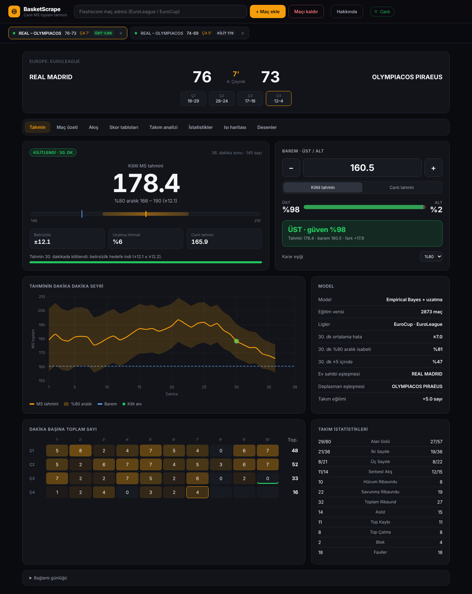

> **Scope:** FIBA format only (4 × 10-minute quarters, 5-minute overtimes). NBA (12-minute quarters) and NCAA (20-minute halves) are not supported yet.

---

## Contents

- [Architecture](#architecture)
- [Quick start](#quick-start)
- [Configuration](#configuration)
- [Prediction panel](#prediction-panel)
- [Analysis views](#analysis-views)
- [Machine learning](#machine-learning)
- [Testing](#testing)
- [Deployment](#deployment)
- [Project structure](#project-structure)
- [Documentation](#documentation)

---

## Architecture

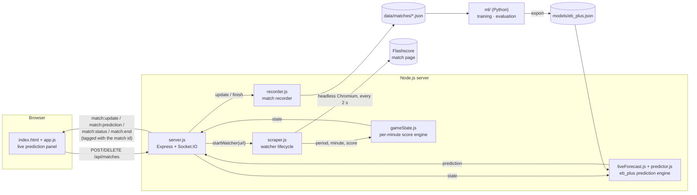

| Component | Responsibility |
|---|---|
| `src/server.js` | HTTP API, Socket.IO broadcast, snapshot of every match for late-joining windows |
| `src/matchManager.js` | Several matches at once: one session (watcher, recorder, forecast) per match, events tagged with the match id, resumes open matches after a restart |
| `src/browserPool.js` | One shared headless Chrome; each match is a tab (images, fonts and video are not loaded) |
| `src/scraper.js` | Browser lifecycle: wait for tip-off → main loop → finish. Crash recovery and stale-page reload |
| `src/parse.js` | Pure parsers for period, minute, score and match status text; Flashscore URL allow-list |
| `src/gameState.js` | Converts cumulative scores into per-minute points (baseline, overwrites, overtime, score corrections) |
| `src/recorder.js` | Persists each match as minute-level cumulative scores for model training |
| `src/predictor.js` | JavaScript port of the `eb_plus` model; identical to Python on 200 exported cases. Also served to the browser |
| `src/liveForecast.js` | Per-match forecast: completed-minute inputs, history, lock at the decision minute, league gate |
| `src/demo.js` | Replays a finished game from the dataset instead of scraping (`DEMO_GAME`) |
| `public/` | Panel: match tabs, prediction (`app.js`), analysis views (`analysis-views.js`), About dialog |
| `ml/` | Python package: features, models, time-ordered validation, prediction-minute selection |

---

## Quick start

### Windows: one-click install

Download **[`BasketScrape-Kurulum.bat`](https://github.com/aral-by/basketscrape/raw/main/BasketScrape-Kurulum.bat)** and double-click it. If Windows SmartScreen warns, choose *More info → Run anyway*. The installer:

1. installs Node.js LTS if it is missing (winget, or the official MSI);
2. downloads the app from GitHub into `%LOCALAPPDATA%\BasketScrape` and installs its packages;
3. puts a **BasketScrape** icon on the desktop and in the Start menu, then opens the app.

The icon starts the server in a minimised window and opens the panel in its own app window (Edge or Chrome `--app` mode). On every start it pulls the latest version from GitHub (`scripts/update.js`); recordings and the list of open matches in `data/` are never touched. Clicking the icon while the app is running just opens another window. Closing the minimised console window stops the app.

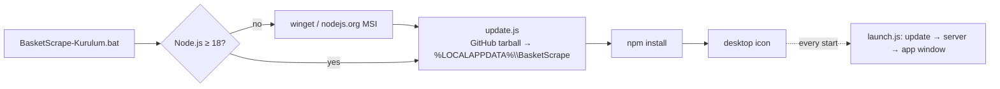

### Any OS

Requires **Node.js ≥ 18**.

```bash
npm install
npm start            # http://localhost:3010
```

1. Paste a Flashscore **EuroLeague** or **EuroCup** match URL and press **+ Maç ekle**. Add as many matches as you like: each gets a tab at the top, and all of them are watched at the same time in one shared Chrome.
2. Matches that have not started yet are watched in the background until tip-off.
3. The panel shows the selected match. Type the bookmaker's line to get the over/under probability; each tab shows its match's verdict.
4. **×** on a tab (or **Maçı kaldır**) stops that match. Open matches resume automatically after a restart.

Other leagues are still tracked and recorded, but the panel shows no prediction: the model has only been validated on EuroLeague and EuroCup.

**Demo without Flashscore:** `DEMO_GAME=random DEMO_SPEED=1500 npm start`, then add any Flashscore URL (several, if you like). Finished games from `ml/datasets/euroleague` are replayed minute by minute.

---

## Configuration

| Variable | Default | Description |
|---|---|---|
| `PORT` | `3010` | HTTP port |
| `PUPPETEER_EXECUTABLE_PATH` | *(bundled Chrome)* | Use a system Chromium (required on Railway/Nix) |
| `DATA_DIR` | `data/matches` | Where match recordings are written |
| `RECORD_MATCHES` | `1` | Set to `0` to disable recording |
| `MODEL_PATH` | `models/eb_plus.json` | Prediction model exported by `python -m basketml export` |
| `DEMO_GAME` | *(off)* | Replay a dataset game (`E2025-013`, `random`) instead of scraping |
| `DEMO_SPEED` | `1500` | Demo: milliseconds per game minute |
| `MAX_MATCHES` | `8` | Matches watched at the same time |
| `SESSIONS_FILE` | `data/sessions.json` | Open matches, resumed after a restart |
| `OPEN_BROWSER` | *(off)* | `1` opens the panel in an app window on start (set by the launcher) |
| `BASKETSCRAPE_BRANCH` | `main` | Branch the installer and updater download |

Only Flashscore URLs are accepted (`flashscore.com`, `flashscore.com.tr`, `flashscore.co.uk`, …). Any other address, including `file://` and internal hosts, is rejected with `400`.

---

## Prediction panel

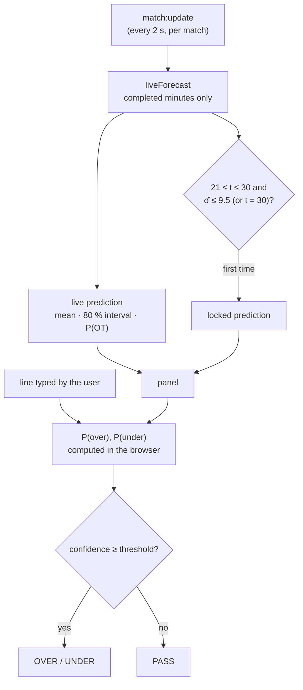

| Card | Content |
|---|---|
| Match tabs | One tab per watched match: score, quarter and minute, live/waiting dot, and the verdict for that match's line (`ÜST %83`, `PAS %64`, `KİLİT 162`). × removes the match |
| Scoreboard | Teams, score, period and minute, quarter scores |
| Prediction | Full-time total, 80 % interval, uncertainty, overtime probability. Phases: early → lock window → locked → final, with the lock's error at the end |
| Line · Over/Under | Probability that the total goes over / under the typed line, from the locked or the live prediction; verdict against a 70–85 % threshold |
| Chart | Prediction and 80 % band minute by minute, the line, the lock point and the final total |
| Minute grid | Total points per minute and per quarter, the lock minute marked |
| Model | Training data, validated error and coverage at the current minute, team matching |

The numbers and formulas are documented in [`docs/formula.md`](docs/formula.md).

---

## Analysis views

Below the scoreboard, each match has eight views. **Tahmin** is the prediction panel above; the other seven bring back everything from the old analysis page in the new design, with more detail.

| View | Content |
|---|---|
| **Tahmin** | Full-time total forecast, 80 % interval, overtime probability, lock, over/under verdict, forecast chart, minute grid, model card |
| **Maç özeti** | Largest lead per team, lead changes, ties, best minute, pace vs the EuroLeague/EuroCup average, quarter and half table, longest runs and scoreless spells, margin chart |
| **Akış** | Points per minute, momentum (last 3 minutes), score progression, margin, ×40 and EG10 pace, 5-minute rolling pace vs the league average |
| **Skor tabloları** | Home, total and away grids in four modes: points, ×40, EG10, cumulative |
| **Takım analizi** | 20+ comparisons (FG%, 2P%, 3P%, FT%, eFG%, TS%, turnover rate, ORB%, FTA/FGA, 3PA share, AST/TO, possessions, ratings, rebounds, steals, blocks, fouls), Four Factors radar, ratings, shot chart, point sources |
| **İstatistikler** | Every Flashscore team statistic with comparison bars; fouls highlighted |
| **Isı haritası** | Points per minute for home, away and total |
| **Desenler** | Quarter bars against league averages; the old quarter rules evaluated live, next to how often they actually held in 2873 games |

**Hakkında** (top right) explains the app and shows the version, the model's validated accuracy, how many matches are recorded and where.

<table>
<tr>
<td>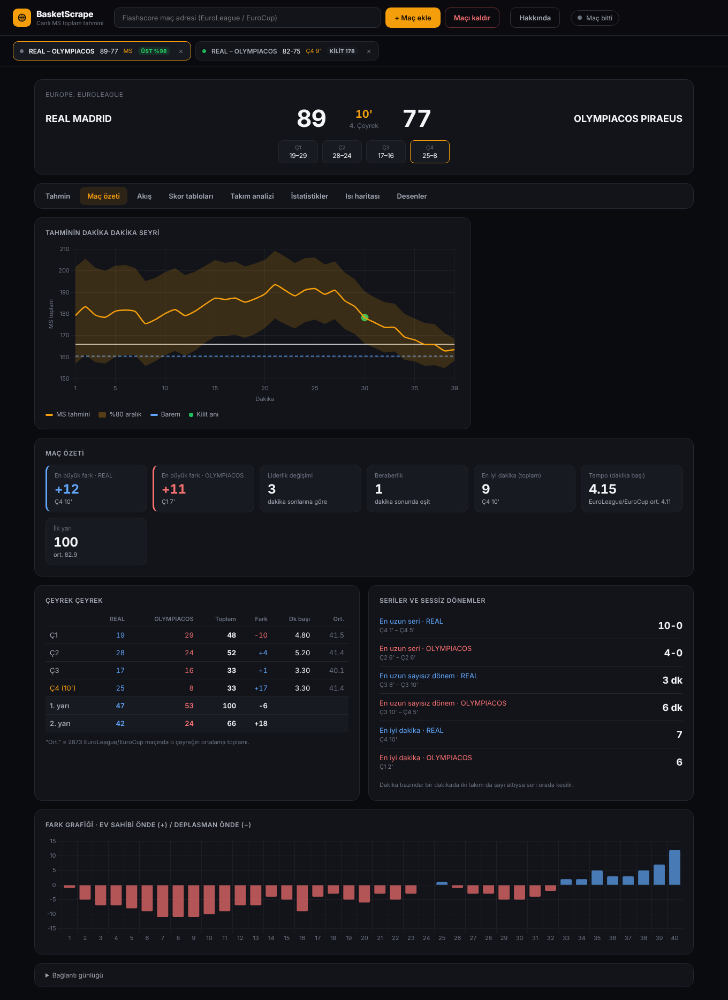<br><sub><b>Maç özeti</b></sub></td>
<td>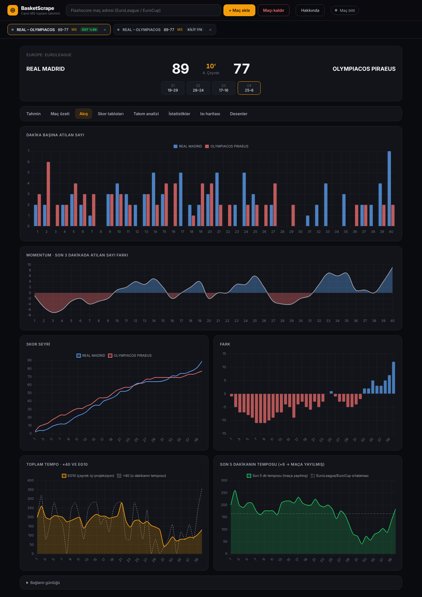<br><sub><b>Akış</b></sub></td>
</tr>
<tr>
<td>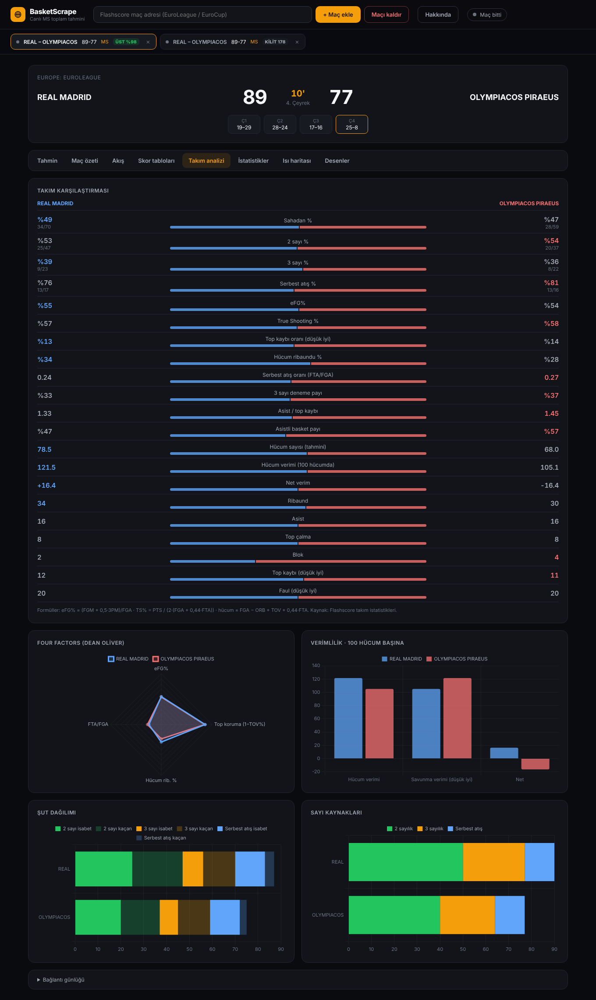<br><sub><b>Takım analizi</b> (demo statistics)</sub></td>
<td>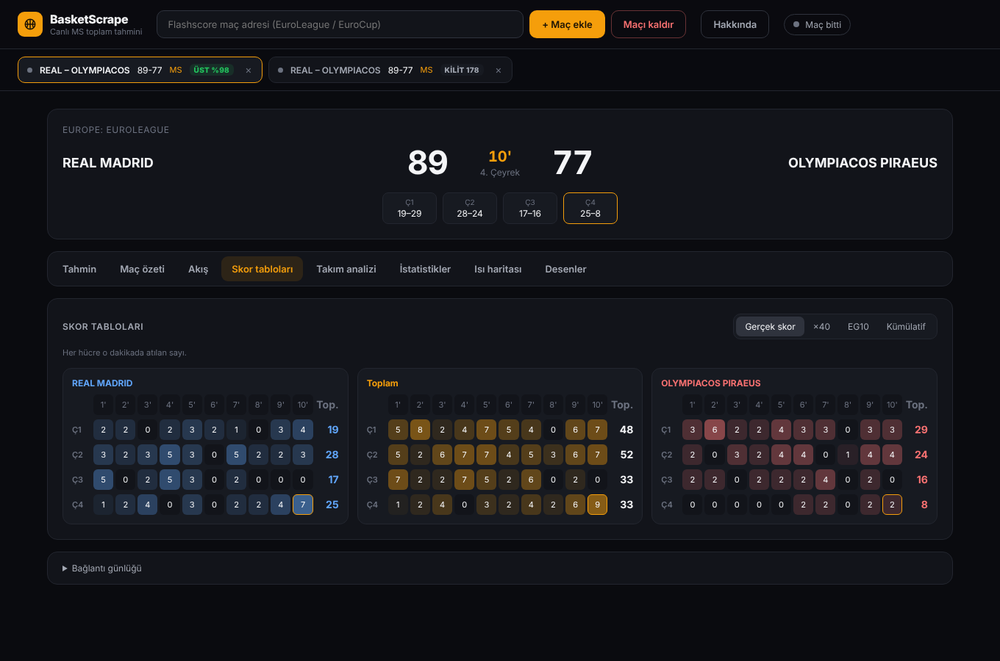<br><sub><b>Skor tabloları</b></sub></td>
</tr>
<tr>
<td>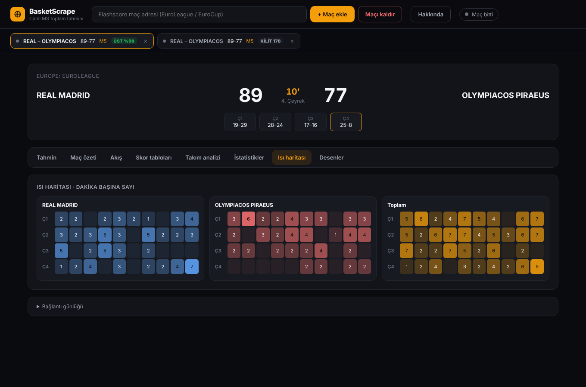<br><sub><b>Isı haritası</b></sub></td>
<td>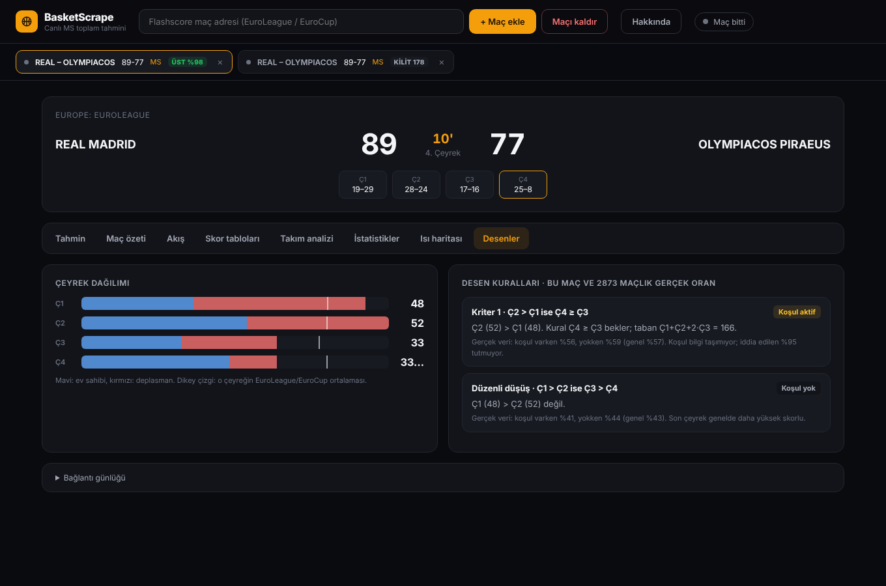<br><sub><b>Desenler</b></sub></td>
</tr>
<tr>
<td>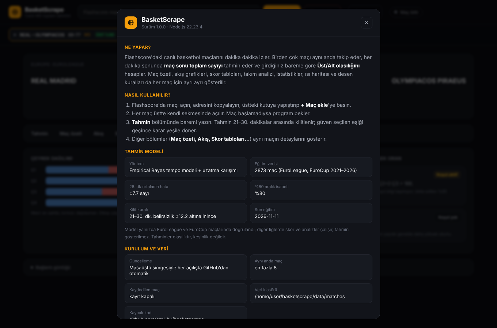<br><sub><b>Hakkında</b></sub></td>
<td>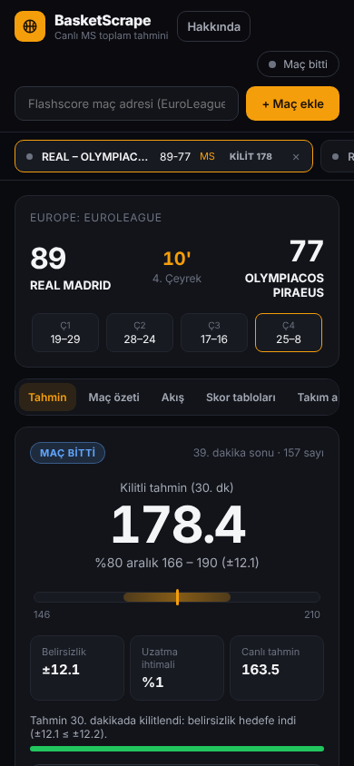<br><sub><b>Mobile</b></sub></td>
</tr>
</table>

Screenshots come from demo mode (`DEMO_GAME=E2025-013`): a real 2025-26 EuroLeague game replayed minute by minute. Team statistics in demo mode are generated and labelled "DEMO"; live matches show Flashscore's statistics. Formulas: [`docs/analysis-metrics.md`](docs/analysis-metrics.md).

---

## Machine learning

Training data: 2873 EuroLeague and EuroCup games (2021-22 to 2026-27) with the score at the end of every minute, pulled from the official live-stats API and checked against the official quarter and final scores (`ml/datasets/euroleague/`). Every match watched live is also written to `data/matches/<date>_<matchId>.json` in the same format. The Python package in `ml/` uses this data to:

- predict the **full-time total** from any live minute, with a calibrated prediction interval;
- decide **which minute of the third quarter** to commit to a prediction;
- test the **quarter-pattern hypotheses** (for example *"if Q2 > Q1 then Q4 ≥ Q3"*) against real data.

```bash
python -m venv .venv && .venv/bin/pip install -r ml/requirements.txt
cd ml
../.venv/bin/python -m basketml evaluate --data datasets/euroleague
../.venv/bin/python -m basketml kriter1  --data datasets/euroleague
../.venv/bin/python -m basketml export   --data datasets/euroleague \
    --parity-out ../test/fixtures/predictor_parity.json        # → models/eb_plus.json
```

| Minute | Mean absolute error | 80 % interval coverage |
|---|---|---|
| 21 | 9.3 | 0.82 |
| 28 | 7.7 | 0.80 |
| 30 | 7.0 | 0.81 |
| 36 | 5.3 | 0.81 |

Out-of-sample, time-ordered validation on 1724 games. Predicting the league mean without in-game information gives 14.7.

The full design, the mathematics and the sample-size analysis are in [`docs/ml-design.md`](docs/ml-design.md).

---

## Testing

```bash
npm test                                   # Node: 63 tests
cd ml && ../.venv/bin/python -m pytest     # Python: 35 tests
```

| Suite | Covers |
|---|---|
| `test/gameState.test.js` | Per-minute derivation, baselines, overtime indexing, score corrections, invalid input |
| `test/parse.test.js` | Period, minute, score and status parsing in Turkish and English; URL allow-list |
| `test/scraper.test.js` | Watcher lifecycle against a fake Puppeteer: stop before tip-off, finish, crash recovery; several matches sharing one browser |
| `test/matchManager.test.js` | Several matches at once: duplicates, limit, per-match events, removal, finished matches, resume after restart |
| `test/analysis.test.js` | Analysis views: cumulative scores after a mid-match join, EG10 rounding, lead changes, runs, droughts, statistic matching, Four Factors |
| `test/update.test.js` | GitHub tarball parsing (pax long names, unsafe paths), updates that keep `data/` and remove deleted files |
| `test/recorder.test.js` | Recording format, mid-match starts, overtime, merging restarted sessions |
| `test/predictor.test.js` | Parity with the Python model, team/league matching, completed-minute inputs, lock rule, league gate |
| `ml/tests/` | No look-ahead leakage, model behaviour, calibration, validation folds, minute selection |

No test needs a browser or network access. The Windows batch files cannot be tested here; `scripts/update.js` and `scripts/launch.js`, which do the actual work, are.

---

## Deployment

- **Windows PC (recommended for daily use):** `BasketScrape-Kurulum.bat`, see [Quick start](#quick-start). Updates arrive automatically when the app starts.
- **Server:** `nixpacks.toml` configures Railway with a system Chromium. Container file systems on most platforms are ephemeral: mount a persistent volume and point `DATA_DIR` and `SESSIONS_FILE` at it, or recordings and the list of open matches are lost on every redeploy.

Every open match is a tab in one shared Chromium, so memory grows with the number of matches. Images, fonts and video are not loaded. `MAX_MATCHES` caps concurrent matches at 8 by default.

---

## Project structure

```
basketscrape/
├── src/
│   ├── server.js        HTTP API + Socket.IO
│   ├── matchManager.js  several matches at once, resume after restart
│   ├── browserPool.js   one shared Chromium, one tab per match
│   ├── openApp.js       opens the panel as an app window
│   ├── scraper.js       watcher lifecycle (Puppeteer)
│   ├── parse.js         text parsers + URL allow-list
│   ├── gameState.js     per-minute score engine
│   ├── recorder.js      match recordings for ML
│   ├── predictor.js     eb_plus model in JavaScript (Node + browser)
│   ├── liveForecast.js  live forecast and lock
│   └── demo.js          dataset replay instead of scraping
├── models/eb_plus.json  exported model (parameters, team context, validation)
├── public/              panel: index.html, app.js (prediction, tabs), analysis-views.js
│                        (summary, flow, tables, team, stats, heat map, patterns), icon
├── test/                Node test suite
├── ml/
│   ├── basketml/        data · features · models · evaluate · timing · simulate
│   └── tests/           pytest suite
├── docs/
│   ├── algo.md          scraping and scoring algorithm
│   ├── formula.md       prediction panel numbers and formulas
│   ├── analysis-metrics.md  analysis view formulas
│   ├── ml-design.md     prediction model design
│   └── images/          screenshots
├── BasketScrape-Kurulum.bat  one-click Windows installer
├── BasketScrape.bat     launcher used by the desktop icon
├── scripts/             update.js (GitHub updater), launch.js (launcher)
└── nixpacks.toml        Railway configuration
```

---

## Documentation

| Document | Topic |
|---|---|
| [`docs/algo.md`](docs/algo.md) | Watcher lifecycle, match-state detection, per-minute score engine, recording format |
| [`docs/formula.md`](docs/formula.md) | Every number on the prediction panel, with its exact formula |
| [`docs/analysis-metrics.md`](docs/analysis-metrics.md) | Formulas behind the analysis views (×40, EG10, Four Factors, ratings, runs, patterns) |
| [`docs/ml-design.md`](docs/ml-design.md) | Final-total prediction: models, validation, minute selection, data requirements |

---

## Tech stack

| Package | Version | Use |
|---|---|---|
| express | ^5.2 | HTTP server, static files |
| socket.io | ^4.8 | Real-time updates |
| puppeteer | ^24 | Headless Chromium |
| chart.js | 4.4.2 (CDN) | Charts |
| numpy · pandas · scikit-learn · scipy | see `ml/requirements.txt` | Modelling and evaluation |
