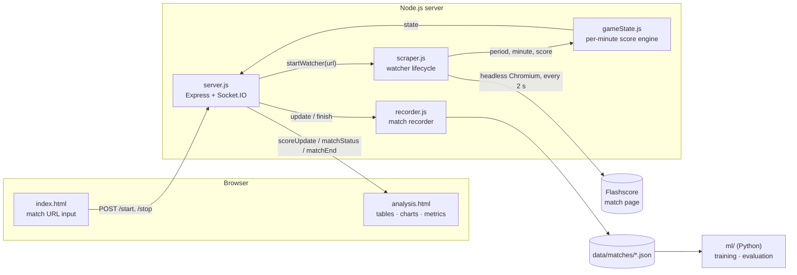
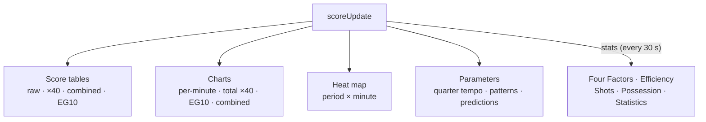

# BasketScrape

Real-time basketball analytics for live Flashscore matches. A headless Chromium session reads the scoreboard every two seconds, converts the cumulative score into **points per minute**, streams the result to a browser dashboard over Socket.IO, and records every watched match as training data for a **final-total (full-time) prediction model**.

> **Scope:** FIBA format only (4 × 10-minute quarters, 5-minute overtimes). NBA (12-minute quarters) and NCAA (20-minute halves) are not supported yet.

---

## Contents

- [Architecture](#architecture)
- [Quick start](#quick-start)
- [Configuration](#configuration)
- [Dashboard](#dashboard)
- [Machine learning](#machine-learning)
- [Testing](#testing)
- [Deployment](#deployment)
- [Project structure](#project-structure)
- [Documentation](#documentation)

---

## Architecture



| Component | Responsibility |
|---|---|
| `src/server.js` | HTTP API, Socket.IO broadcast, single active watcher, snapshot replay for late-joining tabs |
| `src/scraper.js` | Browser lifecycle: wait for tip-off → main loop → finish. Crash recovery and stale-page reload |
| `src/parse.js` | Pure parsers for period, minute, score and match status text; Flashscore URL allow-list |
| `src/gameState.js` | Converts cumulative scores into per-minute points (baseline, overwrites, overtime, score corrections) |
| `src/recorder.js` | Persists each match as minute-level cumulative scores for model training |
| `public/` | Dashboard: score tables, charts, Four Factors, efficiency, heat map, parameters |
| `ml/` | Python package: features, models, time-ordered validation, prediction-minute selection |

---

## Quick start

Requires **Node.js ≥ 18**.

```bash
npm install
npm start            # http://localhost:3010
```

1. Paste a Flashscore basketball match URL and press **Start**.
2. If the match has not started yet, the server keeps checking for tip-off in the background.
3. Open the analysis page; it updates live. Tabs that open later receive the latest state immediately.
4. **Exit Match** stops the scraper, including while it is still waiting for tip-off.

### Multiple instances (Windows)

```bat
kurulum.bat
```

Creates sibling copies `basketscrape-3020`, `-3030`, `-3040` and `-3050`, installs dependencies in each, and writes a `start.bat` that sets `PORT` for that copy.

---

## Configuration

| Variable | Default | Description |
|---|---|---|
| `PORT` | `3010` | HTTP port |
| `PUPPETEER_EXECUTABLE_PATH` | *(bundled Chrome)* | Use a system Chromium (required on Railway/Nix) |
| `DATA_DIR` | `data/matches` | Where match recordings are written |
| `RECORD_MATCHES` | `1` | Set to `0` to disable recording |

Only Flashscore URLs are accepted (`flashscore.com`, `flashscore.com.tr`, `flashscore.co.uk`, …). Any other address, including `file://` and internal hosts, is rejected with `400`.

---

## Dashboard



| Tab | Content |
|---|---|
| Score tables | Period × minute grid per team: raw points, ×40 tempo, combined ×40, EG10 in-period projection |
| Charts | Per-minute line charts and a combined home / away / total view |
| Four Factors | Dean Oliver's eFG%, TOV%, ORB%, FTR as a radar chart |
| Efficiency | Offensive, defensive and net rating; TS% |
| Shots | Made and missed 2PT / 3PT / FT, stacked |
| Possession | Estimated possessions per team |
| Statistics | Flashscore statistics table as published |
| Heat map | Scoring intensity by period and minute |
| Parameters | Quarter tempo bars, pattern checks and the legacy heuristic predictions |

Formulas are documented in [`docs/formula.md`](docs/formula.md). The heuristic predictions on the Parameters tab are not calibrated and are being replaced by the model in [`docs/ml-design.md`](docs/ml-design.md).

---

## Machine learning

Every watched match is written to `data/matches/<date>_<matchId>.json`: the cumulative score at the end of each minute, plus the final score. The Python package in `ml/` uses these recordings to:

- predict the **full-time total** from any live minute, with a calibrated prediction interval;
- decide **which minute of the third quarter** to commit to a prediction;
- test the **quarter-pattern hypotheses** (for example *"if Q2 > Q1 then Q4 ≥ Q3"*) against real data.

```bash
python -m venv .venv && .venv/bin/pip install -r ml/requirements.txt
cd ml
../.venv/bin/python -m basketml evaluate --data ../data/matches
../.venv/bin/python -m basketml kriter1  --data ../data/matches
```

The full design, the mathematics and the sample-size analysis are in [`docs/ml-design.md`](docs/ml-design.md).

---

## Testing

```bash
npm test                                   # Node: 34 tests
cd ml && ../.venv/bin/python -m pytest     # Python: 18 tests
```

| Suite | Covers |
|---|---|
| `test/gameState.test.js` | Per-minute derivation, baselines, overtime indexing, score corrections, invalid input |
| `test/parse.test.js` | Period, minute, score and status parsing in Turkish and English; URL allow-list |
| `test/scraper.test.js` | Watcher lifecycle against a fake Puppeteer: stop before tip-off, finish, crash recovery |
| `test/recorder.test.js` | Recording format, mid-match starts, overtime, merging restarted sessions |
| `ml/tests/` | No look-ahead leakage, model behaviour, calibration, validation folds, minute selection |

No test needs a browser or network access.

---

## Deployment

`nixpacks.toml` configures Railway with a system Chromium. Container file systems on most platforms are ephemeral: mount a persistent volume and point `DATA_DIR` at it, or match recordings are lost on every redeploy.

---

## Project structure

```
basketscrape/
├── src/
│   ├── server.js        HTTP API + Socket.IO
│   ├── scraper.js       watcher lifecycle (Puppeteer)
│   ├── parse.js         text parsers + URL allow-list
│   ├── gameState.js     per-minute score engine
│   └── recorder.js      match recordings for ML
├── public/              dashboard (HTML, CSS, JS)
├── test/                Node test suite
├── ml/
│   ├── basketml/        data · features · models · evaluate · timing · simulate
│   └── tests/           pytest suite
├── docs/
│   ├── algo.md          scraping and scoring algorithm
│   ├── formula.md       dashboard metrics
│   └── ml-design.md     prediction model design
├── kurulum.bat          multi-instance setup (Windows)
└── nixpacks.toml        Railway configuration
```

---

## Documentation

| Document | Topic |
|---|---|
| [`docs/algo.md`](docs/algo.md) | Watcher lifecycle, match-state detection, per-minute score engine, recording format |
| [`docs/formula.md`](docs/formula.md) | Every metric shown on the dashboard, with its exact formula |
| [`docs/ml-design.md`](docs/ml-design.md) | Final-total prediction: models, validation, minute selection, data requirements |

---

## Tech stack

| Package | Version | Use |
|---|---|---|
| express | ^5.2 | HTTP server, static files |
| socket.io | ^4.8 | Real-time updates |
| puppeteer | ^24 | Headless Chromium |
| chart.js | 4.4.2 (CDN) | Charts |
| numpy · pandas · scikit-learn · scipy | see `ml/requirements.txt` | Modelling and evaluation |
