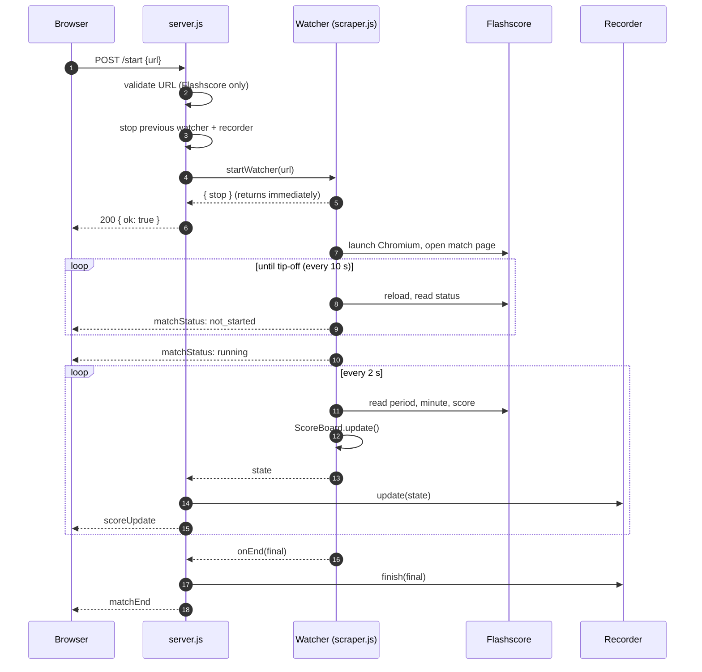
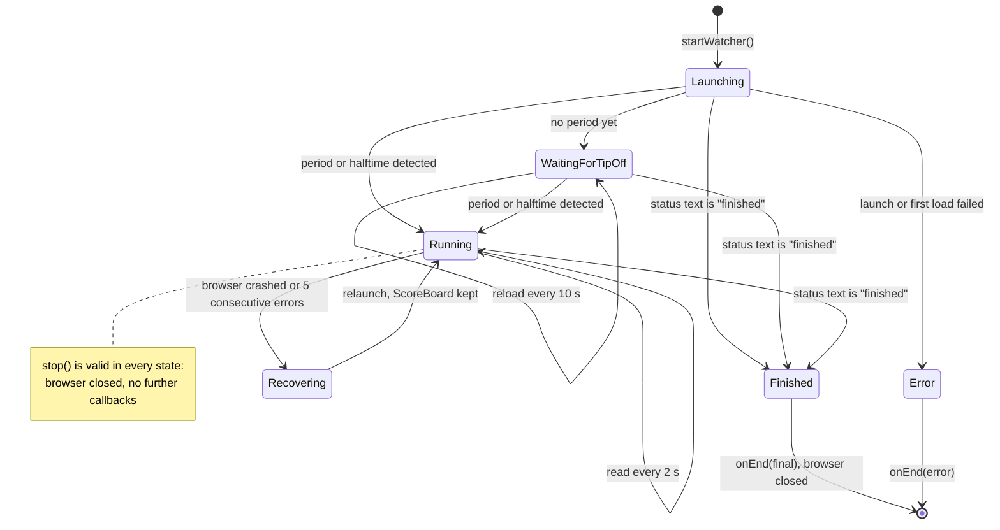
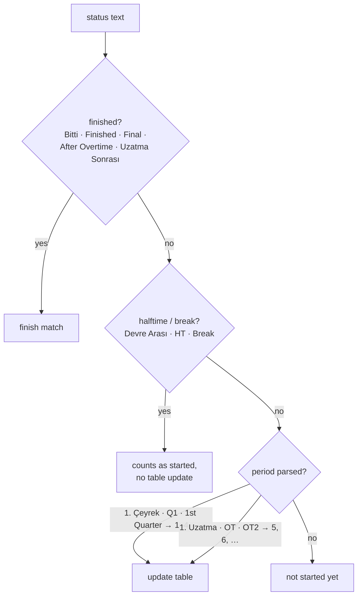
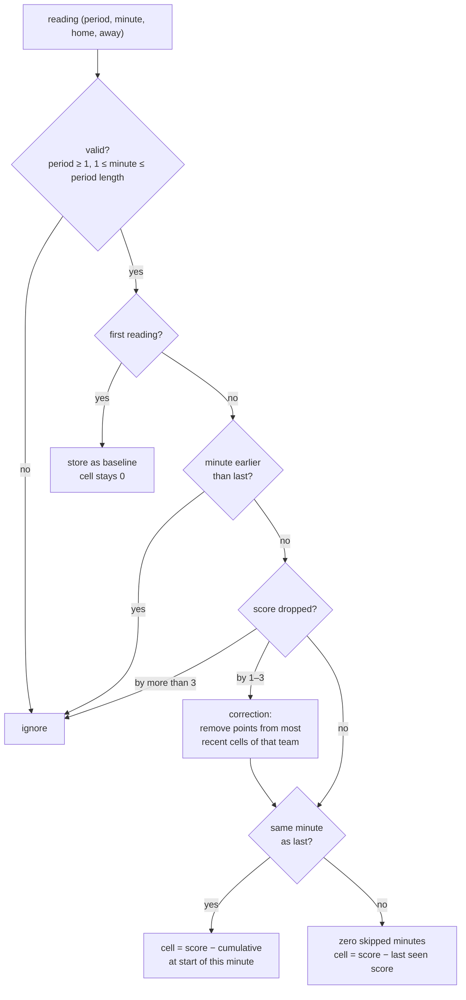
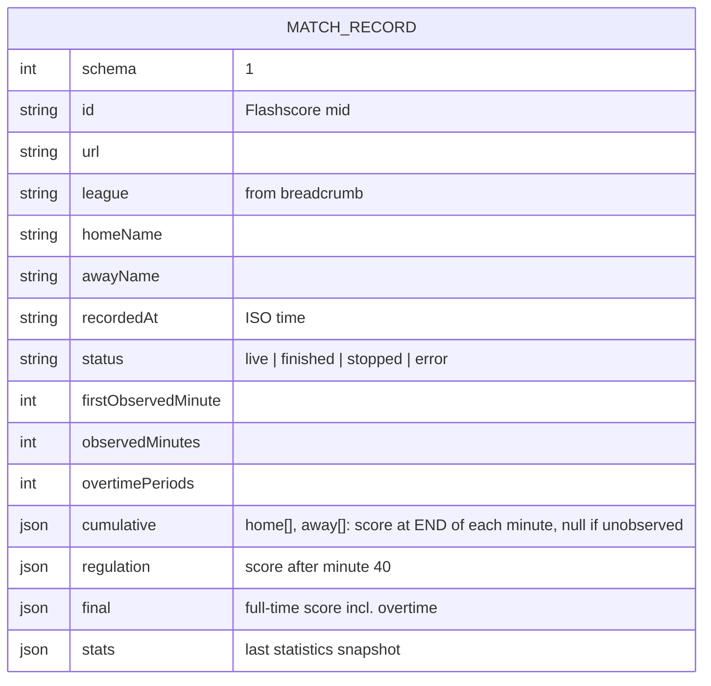

# Scraping and Scoring Algorithm

This document describes how a Flashscore match page becomes a per-minute scoring table: the watcher lifecycle, how match state is detected, how cumulative scores are converted into points per minute, and how matches are recorded.

---

## 1. Request flow



`/start` returns as soon as the watcher is created. Waiting for tip-off can take hours, so it happens in the background, and `/stop` can cancel the watcher at any point.

Callbacks from a watcher that is no longer the active one are ignored, so a late event from a stopped match can never overwrite the state of the current one.

---

## 2. Watcher lifecycle



| Parameter | Value | Purpose |
|---|---|---|
| Main loop interval | 2 s | Score sampling rate |
| Tip-off polling | 10 s | Page reload while waiting for the match to start |
| Statistics refresh | 30 s | Re-reads the statistics tab |
| Stale-page reload | 120 s | Reloads if period, minute and score have not changed |
| Error threshold | 5 | Consecutive failed reads before the browser is relaunched |

The basketball clock stops often, so a minute can last several real minutes. The 120-second stale threshold is set so that a reload during a normal stoppage is harmless.

`networkidle2` timeouts are common on Flashscore because of ads and websockets. A timeout is logged and the page is used as it is, instead of being treated as a failure.

---

## 3. Reading the page

Each field has an ordered list of selectors, and the first one that returns non-empty text wins. CSS selectors are tried before XPath fallbacks. When Flashscore changes its markup, a new selector is **prepended**, never substituted, so older layouts keep working.

| Field | Primary selector |
|---|---|
| Team names | `.duelParticipant__home/__away .participant__participantName` |
| Score | `.detailScore__wrapper > span:first-child / :last-child` |
| Status / period | `.smh__stage`, `[class*="status"] > span:first-child`, … |
| Minute | `.detailScore__status .eventTime` |
| League | `nav[data-testid="wcl-breadcrumbs"]` |
| Statistics tab | `[data-testid="wcl-tab-statistics"]` |

If the period selector finds nothing, the scraper logs nearby elements whose class or text mentions score, stage, status, quarter or minute, so that the new selector can be identified quickly.

### Match-state detection

All decisions come from the status text (`src/parse.js`):



The finish check runs first: "Uzatma Sonrası" (after overtime) also contains "Uzatma", which would otherwise be parsed as overtime period 5.

Scores are parsed digits-only. A placeholder such as `-` before tip-off yields `null`, never `0`, so it cannot be mistaken for a real 0–0.

---

## 4. Per-minute score engine

Flashscore shows the **cumulative** score. The engine (`src/gameState.js`) derives the points scored in each minute.

### 4.1 Absolute minute

The minute counter restarts every period, so each reading is mapped to an absolute minute. Quarters are 10 minutes and overtimes are 5 minutes:

```math
m_{abs} =
\begin{cases}
10\,(p-1) + m, & p \le 4 \ \text{(quarters)}\\
40 + 5\,(p-5) + m, & p \ge 5 \ \text{(overtimes)}
\end{cases}
```

| Period | Minute | Absolute minute |
|---|---|---|
| Q1 | 3 | 3 |
| Q3 | 7 | 27 |
| Q4 | 10 | 40 |
| OT1 | 1 | 41 |
| OT2 | 1 | 46 |

The table starts with 40 cells and grows by 5 per overtime.

### 4.2 Update rules



**Baseline.** When the scraper joins mid-match, the first reading becomes the baseline and its cell stays 0. No points are invented for minutes that were not observed.

**Same-minute overwrite.** A reading arrives every 2 seconds, so each game minute receives many readings. Each overwrites the cell instead of adding to it, so the stored value equals the last reading of that minute minus the cumulative score at the start of the minute.

```
minute 7 starts at 49
  read 1 → 51   cell = 2
  read 2 → 54   cell = 5   ← last reading of minute 7 is kept
minute 8 starts at 54
```

**Skipped minutes.** If a reading jumps from minute 7 to minute 9, minute 8 is set to 0 and every point since the last reading is attributed to minute 9.

**Score corrections.** Flashscore sometimes lowers a score, for example when a three-pointer is changed to a two. A drop of up to 3 points is treated as a correction: the difference is removed from that team's most recent non-zero cells, and the other team's data is untouched. Larger drops are treated as misreads and the whole reading is ignored.

The engine maintains this invariant after every update:

```math
\text{cumulative at start of current minute} + \text{current cell} = \text{last seen score}
```

**Halftime.** Readings during a break are not written to the table.

---

## 5. Match recordings

`src/recorder.js` writes one file per match to `data/matches/<date>_<matchId>.json`. The match id is the Flashscore `mid` parameter.



Design decisions:

- **Cumulative, not per-minute.** The raw scoreboard value per minute is stored. Per-minute points can always be derived from it, and the absolute score stays known even when the match was joined late.
- **Gaps stay `null`.** Unobserved minutes are never filled in.
- **Restart-safe.** If the same match is started again (refresh, server restart), the existing file is loaded and earlier observations are kept.
- **Atomic writes.** Each write goes to a temporary file that is then renamed. Files are written once per minute, not every 2 seconds.
- **Nothing to learn, no file.** A match that finishes without a single observed minute (for example, one that was already over) is not saved.
