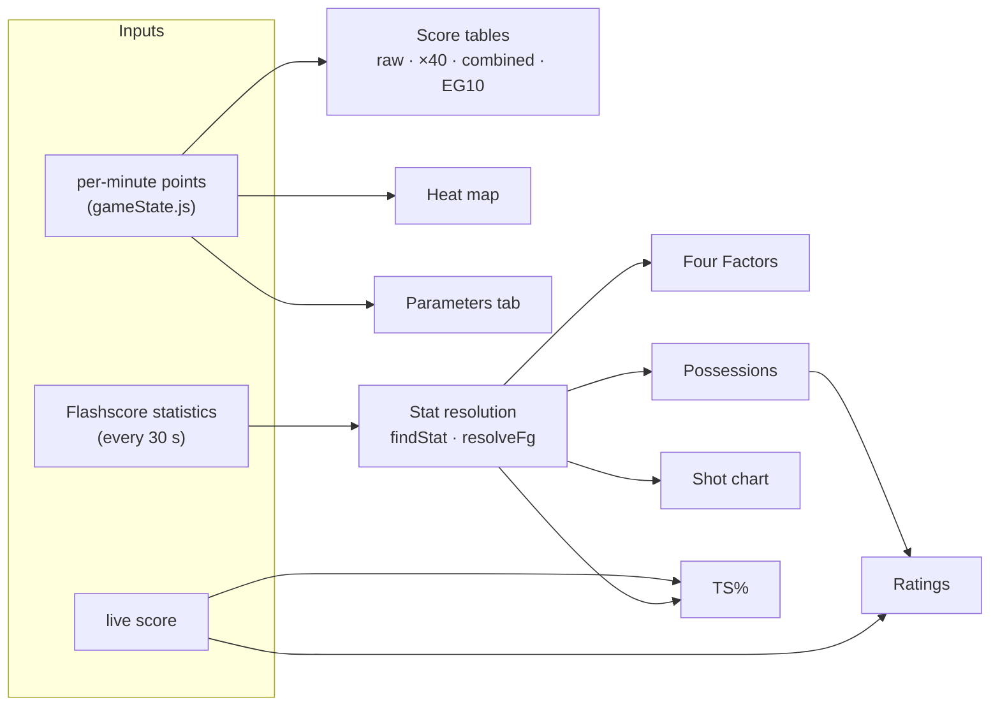
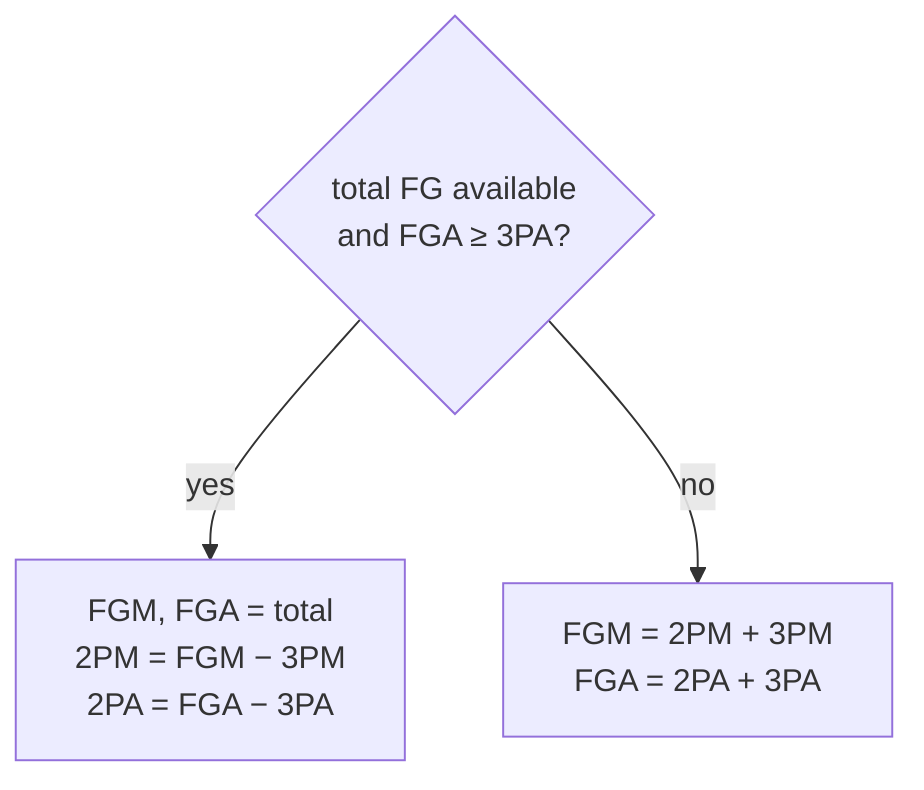

# Analysis Views: Metrics

Formulas behind the analysis views of the panel (**Maç özeti, Akış, Skor tabloları, Takım analizi, İstatistikler, Isı haritası, Desenler**). They are implemented in `public/analysis-views.js`; the pure calculations (`BasketAnalysis.calc`) are unit-tested in `test/analysis.test.js`. The prediction panel's own numbers are in [`formula.md`](formula.md).

The sections below come from the old analysis page and still apply. §8 covers what the new views add.



Notation: `m` is the absolute minute (1–40, then 41+ for overtime) and `x_m` is the points scored in minute `m`.

---

## 1. Score tables

| Table | Cell value | Meaning |
|---|---|---|
| Raw | `x_m` | Points in that minute |
| ×40 | `40 · x_m` | That minute's scoring rate extended over a full game |
| Combined ×40 | `40 · (x_m(home) + x_m(away))` | Same for both teams together |
| EG10 | see below | In-period projection to a full game |

### EG10

EG10 projects the scoring rate **within the current period** to a full 40-minute game. It restarts at the beginning of each period. For minute `j` of a period:

```math
\mathrm{EG10}_j = \operatorname{round}_{0.7}\!\left( \frac{40}{j} \sum_{i=1}^{j} x_i \right),
\qquad
\operatorname{round}_{0.7}(v) =
\begin{cases}
\lfloor v \rfloor + 1, & v - \lfloor v \rfloor \ge 0.7\\
\lfloor v \rfloor, & \text{otherwise}
\end{cases}
```

The custom rounding goes up only when the fractional part is at least 0.7. Overtime periods use the same formula over their 5 minutes.

---

## 2. Statistic resolution

Flashscore labels differ by language and competition. `findStat` tries the keywords in order (most specific first) and returns the first statistic whose name contains one of them. The views also read total rebounds (`toplam rib`, `total reb`), steals (`top çal`, `steal`), blocks (`blok`, `block`) and fouls (`faul`, `foul`).

| Quantity | Keywords |
|---|---|
| Field goals (total) | `alan gol`, `sahadan`, `field goal` |
| 2-pointers only | `iki say`, `2 say`, `2-say` |
| 3-pointers | `üç say`, `3 say`, `üçlük`, `three` |
| Free throws | `serbest atış`, `free throw`, `serbest` |
| Offensive rebounds | `hücum rib`, `ofansif r`, `off reb` |
| Defensive rebounds | `savunma rib`, `defansif r`, `def reb` |
| Turnovers | `top kayb`, `turnover`, `kayıp` |
| Assists | `asist`, `assist` |

Values such as `24/51` are parsed as made / attempted. Flashscore's "Alan Golü" is **total** field goals (2PT + 3PT). `resolveFg` therefore derives two-pointers instead of adding them twice:



---

## 3. Four Factors (Dean Oliver)

| Factor | Formula | Shown on radar as |
|---|---|---|
| Effective FG% | `eFG% = (FGM + 0.5 · 3PM) / FGA` | `eFG%` |
| Turnover rate | `TOV% = TOV / (FGA + 0.44 · FTA + TOV)` | `1 − TOV%`, so that higher is better |
| Offensive rebound rate | `ORB% = ORB / (ORB + opponent DRB)` | `ORB%` |
| Free throw rate | `FTR = FTA / FGA` | `min(FTR, 1)` |

All four axes share a 0–1 scale. Any denominator of 0 is replaced by 1, and non-finite results are shown as 0.

---

## 4. Possessions and efficiency

Possessions per team use Oliver's estimate, with a floor of 1:

```math
\mathrm{Poss} = \max\left(1,\ \mathrm{FGA} - \mathrm{ORB} + \mathrm{TOV} + 0.44 \cdot \mathrm{FTA}\right)
```

Ratings use the **average** of both teams' possessions as a common denominator, because both teams have almost the same number of possessions in a game:

| Metric | Formula |
|---|---|
| Average possessions | `avgPoss = (Poss_home + Poss_away) / 2` |
| Offensive rating | `OffRtg = 100 · PTS / avgPoss` |
| Defensive rating | `DefRtg = opponent's OffRtg` |
| Net rating | `NetRtg = OffRtg − DefRtg` |
| True shooting % | `TS% = PTS / (2 · (FGA + 0.44 · FTA))` |

`PTS` comes from the live score (every 2 s) and the box-score inputs from the statistics tab (every 30 s), so mid-game ratings can lag the score by up to 30 seconds.

---

## 5. Shot chart

Stacked bars per team:

| Segment | Value |
|---|---|
| 2PT made / missed | `2PM`, `2PA − 2PM` |
| 3PT made / missed | `3PM`, `3PA − 3PM` |
| FT made / missed | `FTM`, `FTA − FTM` |

---

## 6. Heat map

One canvas per team: 4 periods (columns) × 10 minutes (rows). The colour opacity of each cell is

```math
\alpha_m = 0.05 + 0.90 \cdot \frac{x_m}{\max_k x_k}
```

and minutes without points stay empty. No numbers are drawn.

---

## 7. Old Parameters tab

The old page's score-based prediction heuristics ("Tahmin A/B", winner factor) are gone: they were hand-written formulas with fixed "confidence" values. The calibrated model on the **Tahmin** view replaces them ([`ml-design.md`](ml-design.md), [`formula.md`](formula.md)). The quarter bars and the two pattern rules live on in **Desenler**, now with their measured hit rates (§8).

---

## 8. Added in the new views

All of these use minute resolution: the scraper knows the score at the end of each minute, not the order of baskets inside a minute.

| Metric | Definition |
|---|---|
| Cumulative score | Walked back from the live score through the per-minute cells, so it is right even when the session joined mid-game |
| Margin | `home − away` at the end of each minute |
| Lead changes | Number of times the sign of the margin flips (ties are skipped) |
| Ties | Minutes that end level (excluding 0–0) |
| Largest lead | Maximum margin per team and the minute it happened |
| Run | Consecutive minutes in which only one team scored; a scoreless minute keeps the run open, a minute where both scored ends it. Shown as `12-0` with its start and end minute |
| Scoreless spell | Longest stretch of minutes in which a team did not score |
| Momentum | `Σ (home − away)` over the last 3 minutes |
| Rolling pace | Average points per minute over the last 5 minutes × 40 |
| Quarter reference | Mean quarter totals over 2873 EuroLeague/EuroCup games: 41.5 · 41.4 · 40.1 · 41.4 |

### Team analysis additions

| Metric | Formula |
|---|---|
| 2P%, 3P%, FT%, FG% | made / attempted |
| 3-point attempt share | `3PA / FGA` |
| AST/TO | `AST / TOV` |
| Assisted share | `AST / FGM` |
| Point sources | `2·2PM`, `3·3PM`, `FTM` |
| Fouls | Flashscore's foul row, when published |

Statistic names are matched with ordered keywords, most specific first, so "Toplam Ribaund" is never mistaken for "Hücum Ribaundu".

### Patterns, measured

The old quarter rules are evaluated live and shown next to how often they held in 2873 games:

| Rule | Held when the condition was met | Held otherwise |
|---|---|---|
| Criterion 1: Q2 > Q1 ⇒ Q4 ≥ Q3 | 56.1 % | 58.7 % |
| Regular decline: Q1 > Q2 ⇒ Q3 > Q4 | 40.8 % | 44.1 % |

Neither condition carries information. The fourth quarter is usually at least as high-scoring as the third.
