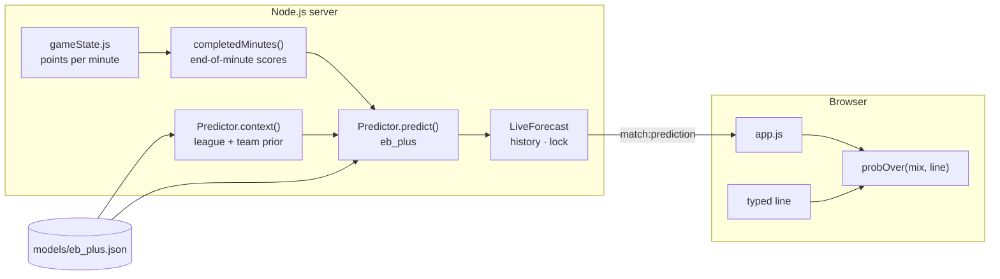
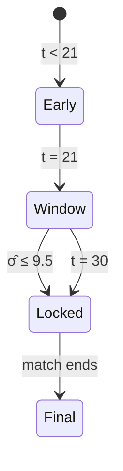

# Prediction Panel: Numbers and Formulas

Every number on the panel, where it comes from, and the code that computes it. The model itself (why these formulas, how they were validated) is described in [`ml-design.md`](ml-design.md).



Notation: `t` is the number of **completed** minutes (1–39), `S_t` the total score at the end of minute `t`, `r = 40 − t` the regulation minutes left.

---

## 1. Model inputs: completed minutes only

The model was trained on end-of-minute scores. The minute in progress is not finished, so the newest input is minute `t = m − 1`, where `m` is the live minute:

```math
S_{m-1} = \text{live score} - \text{points scored so far in minute } m
```

`completedMinutes()` walks back from the live score through the per-minute cells. When the session joined mid-game at minute `j`, minutes before `j` are unknown and are not reconstructed, so the history starts at `t = j`.

A prediction therefore updates once per game minute, as soon as the next minute begins.

## 2. Pre-game context

`Predictor.context(league, home, away)` reads the exported state:

| Value | Meaning |
|---|---|
| `lg_recent` | Recent league mean of the regulation total (EWMA, half-life 150 games) |
| `team_dev` | Sum of the two teams' scoring tendency (shrunk EWMA deviation from the league mean) |

League names are normalised and suffix-matched, so `EUROPE: Euroleague` and `EUROLEAGUE 2025-26` both resolve to `euroleague`. Team names are matched by shared words; when several model teams match (sponsor renames), the most recent one wins. A team that is not found contributes 0.

**League gate.** If the league is not one the model was trained on (EuroLeague, EuroCup), the panel shows no prediction.

## 3. Full-time total

```math
\mu = \frac{b_0 + b_1\,\text{lg\_recent} + b_2\,\text{team\_dev}}{40}, \qquad
\hat\lambda_t = \frac{S_t + k\mu}{t + k}
```

```math
\hat R^{\text{reg}}_t = \rho_t\,\hat\lambda_t\,r, \qquad
\hat T = S_t + \hat R^{\text{reg}}_t + p_{OT}\,E_{OT}
```

| Panel label | Value |
|---|---|
| **MS toplam tahmini** | `T̂` |
| **%80 aralık** | `T̂ ± 1.2816 · σ̂` |
| **Belirsizlik** | `± 1.2816 · σ̂`, the half-width of the 80 % interval |
| **Uzatma ihtimali** | `p_OT` |
| **Canlı tahmin** | `T̂` at the newest completed minute, even after the lock |

### Uncertainty

```math
\operatorname{Var}_{\text{reg}} = \varphi\left[\rho_t\hat\lambda_t r + \frac{(\rho_t r)^2\hat\lambda_t}{t+k}\right]
```

```math
\hat\sigma = c_t\sqrt{\operatorname{Var}_{\text{reg}} + p_{OT}V_{OT} + p_{OT}(1-p_{OT})E_{OT}^2}
```

`c_t` (`sd_scale`) rescales the standard deviation so that the 80 % interval covered exactly 80 % of the training games.

### Overtime probability

```math
z = \frac{|\text{margin}|}{\sqrt{\varphi\,\rho_t\hat\lambda_t r + 1}}, \qquad
p_{OT} = \frac{1}{1 + e^{-(a + c_1 z + c_2 z^2)}}
```

`E_OT` and `V_OT` are the mean and variance of the points scored in overtime by games that went to overtime (25.1 points on average).

## 4. Lock



The prediction is locked at the first completed minute `t` in 21…30 with `σ̂ ≤ 9.5`, that is with an 80 % interval no wider than ±12.2. If that never happens, it is locked at minute 30. On real data this rule fires at minute 28.5 on average, with a mean error of 7.5 points (`ml-design.md` §6, §9).

After the match ends, the panel shows the final total and the lock's error (`final − locked T̂`).

## 5. Over / under

The total is a two-component mixture: no overtime, or overtime. For a line `L`:

```math
P(\text{over}) = (1-p_{OT})\left[1-\Phi\!\left(\frac{L - \hat T^{\text{reg}}}{c'_t\,\sigma_{\text{reg}}}\right)\right]
+ p_{OT}\left[1-\Phi\!\left(\frac{L - \hat T^{\text{reg}} - E_{OT}}{c'_t\sqrt{\sigma_{\text{reg}}^2 + V_{OT}}}\right)\right]
```

`c'_t` (`reg_scale`) is the interval calibration fitted on games without overtime. Because of the overtime tail the distribution is right-skewed, so `P(total > T̂)` is slightly below 0.5.

The browser computes this from the `mix` object in each prediction, so typing a line gives an instant answer. **Kilitli tahmin / Canlı tahmin** chooses which prediction's mix is used.

| Verdict | Condition |
|---|---|
| **ÜST · güven X** | `P(over) ≥ threshold` |
| **ALT · güven X** | `P(under) ≥ threshold` |
| **PAS** | neither side reaches the threshold (default 80 %) |
| **Kilit bekleniyor** | basis is the locked prediction and no lock exists yet |

On the 1724 validation games, `P(over)` was calibrated: when it said 0.8–0.9, the over won 85.6 % of the time.

## 6. Minute grid and quarter scores

Each cell is `home_m + away_m`, the points scored by both teams in minute `m`. The row total is the quarter (or overtime) total. Cell shading is proportional to the points, the live minute has an orange outline and the lock minute is underlined in green.

## 7. Model card

The validation numbers are taken from `models/eb_plus.json`. `python -m basketml export` computes them out-of-sample and writes them alongside the parameters:

| Row | Source |
|---|---|
| `t. dk ortalama hata` | Out-of-sample MAE at minute `t` |
| `t. dk %80 aralık isabeti` | Share of games inside the 80 % interval at minute `t` |
| `t. dk ±5 içinde` | Share of predictions within 5 points |

`t` is the lock minute once locked, otherwise the current minute.

## 8. Several matches: tabs

Each watched match has its own forecast, lock and line (the line is saved per match in the browser). The panel shows the selected match. Each tab summarises its match:

| Tab badge | Condition |
|---|---|
| **ÜST %x** / **ALT %x** | locked, a line is set and `max(P(over), P(under)) ≥ threshold` |
| **PAS %x** | locked and a line is set, but below the threshold |
| **KİLİT T̂** | locked, no line yet |
| *(none)* | not locked yet, or no prediction for this league |

With **Canlı tahmin** selected, badges use the live prediction before the lock. The threshold is shared by all matches.
