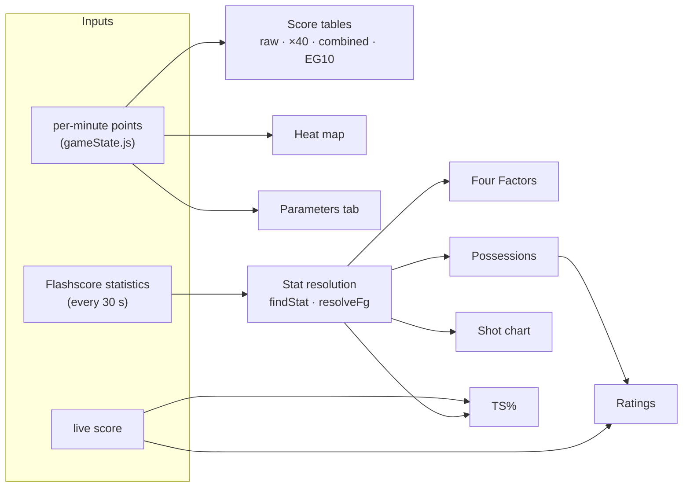
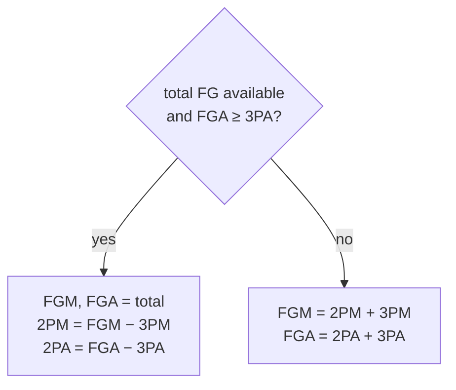
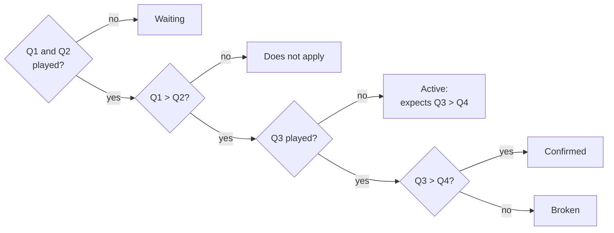

# Dashboard Metrics

Every number shown on the analysis page, with the exact formula used in `public/analysis.js` and `public/analysis.html`.



Notation: `m` is the absolute minute (1–40, then 41+ for overtime) and `x_m` is the points scored in minute `m`.

---

## 1. Score tables

| Table | Cell value | Meaning |
|---|---|---|
| Raw | `x_m` | Points in that minute |
| ×40 | `40 · x_m` | That minute's scoring rate extended over a full game |
| Combined ×40 | `40 · (x_m(home) + x_m(away))` | Same for both teams together |
| EG10 | see below | In-period projection to a full game |

### EG10

EG10 projects the scoring rate **within the current period** to a full 40-minute game. It restarts at the beginning of each period. For minute `j` of a period:

```math
\mathrm{EG10}_j = \operatorname{round}_{0.7}\!\left( \frac{40}{j} \sum_{i=1}^{j} x_i \right),
\qquad
\operatorname{round}_{0.7}(v) =
\begin{cases}
\lfloor v \rfloor + 1, & v - \lfloor v \rfloor \ge 0.7\\
\lfloor v \rfloor, & \text{otherwise}
\end{cases}
```

The custom rounding goes up only when the fractional part is at least 0.7. Overtime periods use the same formula over their 5 minutes.

---

## 2. Statistic resolution

Flashscore labels differ by language and competition. `findStat` looks for the first statistic whose name contains any of a list of Turkish or English keywords:

| Quantity | Keywords |
|---|---|
| Field goals (total) | `alan gol`, `sahadan`, `field goal` |
| 2-pointers only | `iki say`, `2 say`, `2-say` |
| 3-pointers | `üç say`, `3 say`, `üçlük`, `three` |
| Free throws | `serbest atış`, `free throw`, `serbest` |
| Offensive rebounds | `hücum rib`, `ofansif r`, `off reb` |
| Defensive rebounds | `savunma rib`, `defansif r`, `def reb` |
| Turnovers | `top kayb`, `turnover`, `kayıp` |
| Assists | `asist`, `assist` |

Values such as `24/51` are parsed as made / attempted. Flashscore's "Alan Golü" is **total** field goals (2PT + 3PT). `resolveFg` therefore derives two-pointers instead of adding them twice:



---

## 3. Four Factors (Dean Oliver)

| Factor | Formula | Shown on radar as |
|---|---|---|
| Effective FG% | `eFG% = (FGM + 0.5 · 3PM) / FGA` | `eFG%` |
| Turnover rate | `TOV% = TOV / (FGA + 0.44 · FTA + TOV)` | `1 − TOV%`, so that higher is better |
| Offensive rebound rate | `ORB% = ORB / (ORB + opponent DRB)` | `ORB%` |
| Free throw rate | `FTR = FTA / FGA` | `min(FTR, 1)` |

All four axes share a 0–1 scale. Any denominator of 0 is replaced by 1, and non-finite results are shown as 0.

---

## 4. Possessions and efficiency

Possessions per team use Oliver's estimate, with a floor of 1:

```math
\mathrm{Poss} = \max\left(1,\ \mathrm{FGA} - \mathrm{ORB} + \mathrm{TOV} + 0.44 \cdot \mathrm{FTA}\right)
```

Ratings use the **average** of both teams' possessions as a common denominator, because both teams have almost the same number of possessions in a game:

| Metric | Formula |
|---|---|
| Average possessions | `avgPoss = (Poss_home + Poss_away) / 2` |
| Offensive rating | `OffRtg = 100 · PTS / avgPoss` |
| Defensive rating | `DefRtg = opponent's OffRtg` |
| Net rating | `NetRtg = OffRtg − DefRtg` |
| True shooting % | `TS% = PTS / (2 · (FGA + 0.44 · FTA))` |

`PTS` comes from the live score (every 2 s) and the box-score inputs from the statistics tab (every 30 s), so mid-game ratings can lag the score by up to 30 seconds.

---

## 5. Shot chart

Stacked bars per team:

| Segment | Value |
|---|---|
| 2PT made / missed | `2PM`, `2PA − 2PM` |
| 3PT made / missed | `3PM`, `3PA − 3PM` |
| FT made / missed | `FTM`, `FTA − FTM` |

---

## 6. Heat map

One canvas per team: 4 periods (columns) × 10 minutes (rows). The colour opacity of each cell is

```math
\alpha_m = 0.05 + 0.90 \cdot \frac{x_m}{\max_k x_k}
```

and minutes without points stay empty. No numbers are drawn.

---

## 7. Parameters tab (legacy heuristics)

> These rules are hand-written heuristics, not trained models. Their "confidence" values are fixed formulas, not measured probabilities. They are being replaced by the model described in [`ml-design.md`](ml-design.md), which also tests the pattern claims below against recorded matches.

Let `Q1 … Q4` be the combined points per quarter, and `S_t` the cumulative combined score after minute `t`.

### Regular Decline pattern



### Prediction A — halftime (from minute 20)

| Output | Rule |
|---|---|
| Winner | Leader after Q1 + Q2; on a tie, the team that scored more in Q2 |
| Full-time total | `(Q1 + Q2) · 2` |
| Over / Under | `Over` if `Q2 > Q1`, `Under` if `Q2 < Q1`, otherwise neutral |
| Confidence | `min(70 + 2 · |Q2 − Q1|, 95)` % |

### Prediction B — early third quarter (from minute 25)

```math
\text{overall pace} = \frac{S_{25}}{25},\qquad
\text{recent pace} = \frac{S_{25} - S_{15}}{10},\qquad
\widehat{T} = \operatorname{round}\left(S_{25} + 15 \cdot \text{recent pace}\right)
```

| Output | Rule |
|---|---|
| Winner | Leader after minute 25; on a tie, the stronger team in minutes 16–25 |
| Full-time total | `T̂` above |
| Over / Under | `Over` if recent pace > overall pace, `Under` if lower |
| Confidence | `min(55 + 15 · |recent − overall|, 90)` % |
