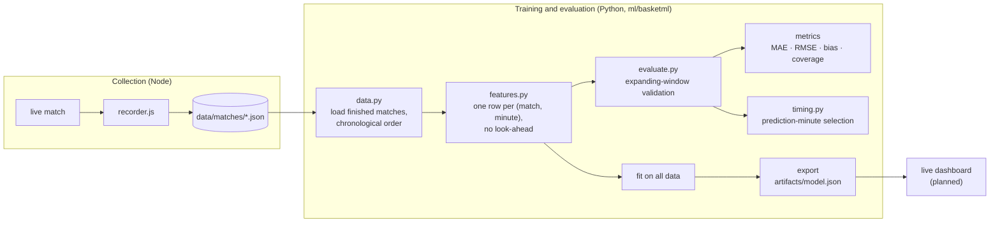
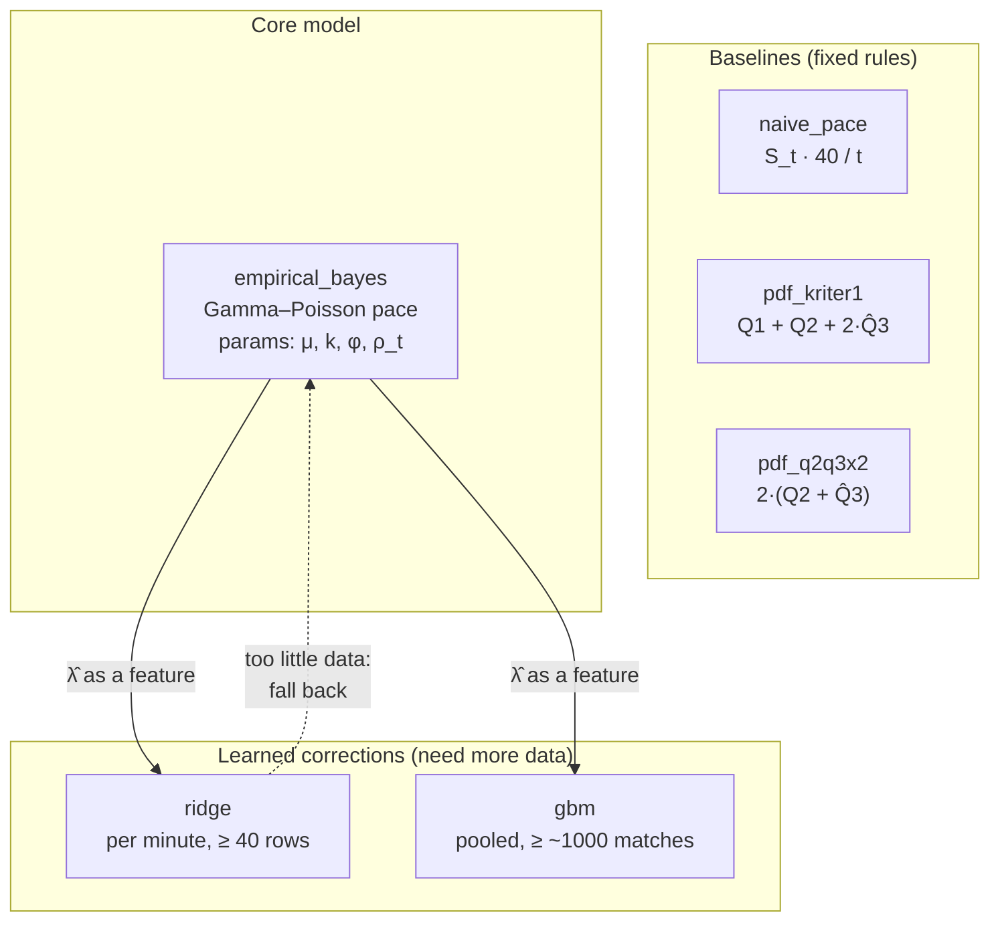
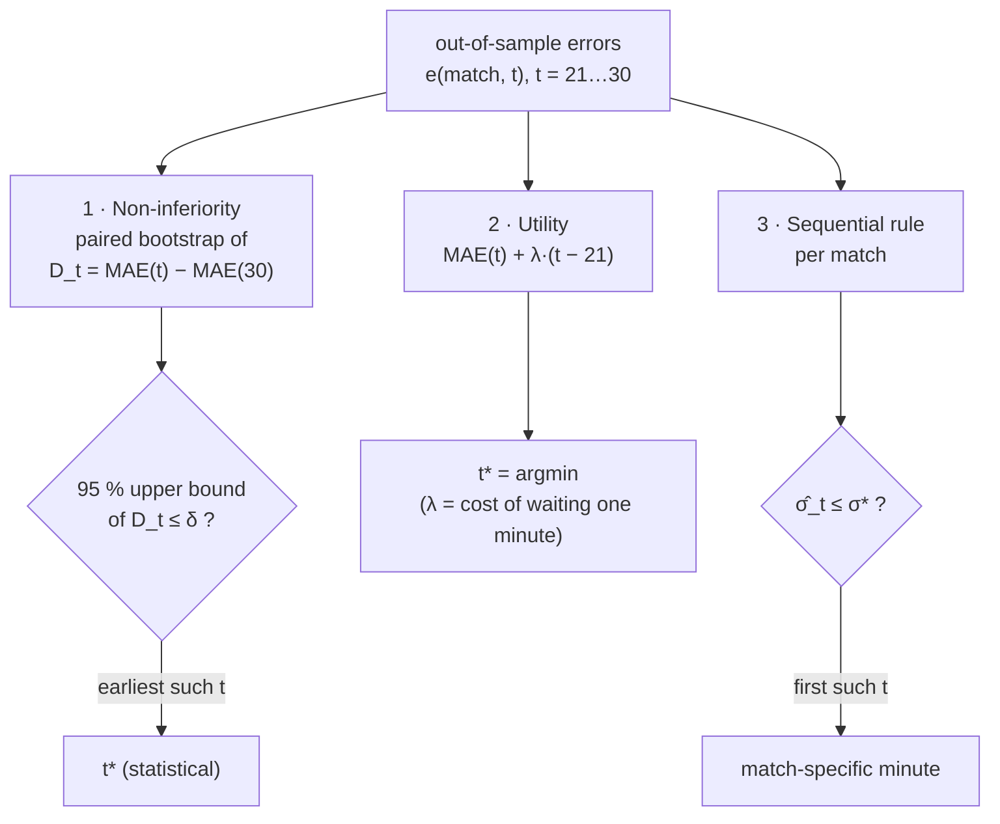
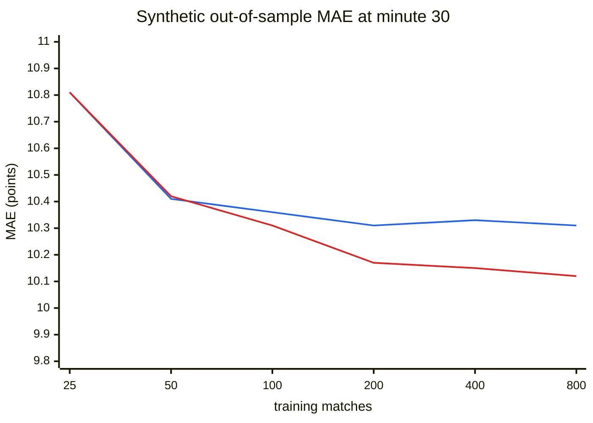
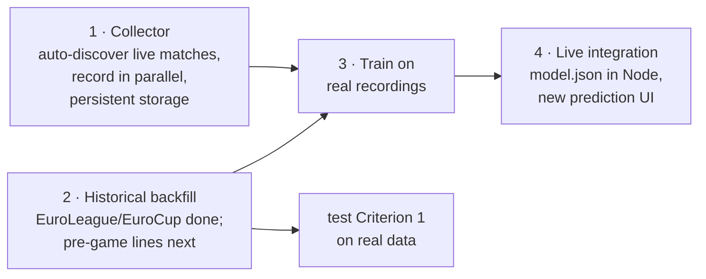

# ML Design: Live Full-Time Total Prediction

## 1. Problem

During a live FIBA game (4 × 10 minutes), at absolute minute `t`:

1. **Predict the full-time total** `y`: the combined score of both teams at the final whistle, overtime included, with a calibrated prediction interval.
2. **Choose the third-quarter minute** at which to commit to that prediction, based on measured accuracy.

| Symbol | Meaning |
|---|---|
| `S_t` | Combined cumulative score after minute `t` |
| `r = 40 − t` | Remaining regulation minutes |
| `y` | Full-time total, overtime included |
| `R_t = y − S_t` | Points still to come; this is what every model predicts |

**No look-ahead.** A row for minute `t` uses only minutes `1 … t`. This is enforced by a unit test (`ml/tests/test_pipeline.py`).

> NBA (4 × 12) and NCAA (2 × 20) formats are out of scope. The live scraper also assumes 10-minute quarters.

---

## 2. Pipeline



---

## 3. Data

### Sources

| Data | Source | Available for past matches? |
|---|---|---|
| Minute-by-minute cumulative score, EuroLeague / EuroCup | Official live-stats API (`basketml/euroleague.py`) | **Yes.** 2873 games, 2021-22 to 2026-27, in `ml/datasets/euroleague/` |
| Minute-by-minute cumulative score, other leagues | Our own live recordings (`src/recorder.js`) | No. Flashscore's point-by-point feed has no timestamps (verified 2026-11). |
| Quarter scores | Flashscore match summary | Yes, for every finished match |
| Pre-game over/under line | Flashscore odds tab | Yes, not collected yet |

Every backfilled game is checked against the official quarter and final scores before it is kept; none of the 2873 failed.

### Record format (schema 1)

Written by `src/recorder.js`; the full format is in [`algo.md`](algo.md#5-match-recordings).

- `cumulative.home[i]`, `cumulative.away[i]`: scoreboard at the end of minute `i + 1`, or `null` if not observed.
- `final`: full-time score.
- `firstObservedMinute`: when the scraper joined.
- `pregameLine`: optional, not collected yet.

When loading, a gap after the first observation is forward-filled with the last known score. Minutes before the first observation stay missing: nothing is fabricated.

### Features at minute `t`

| Feature | Definition |
|---|---|
| `S` | `S_t` |
| `pace` | `S_t / t` |
| `last5`, `last10` | `(S_t − S_{t−5}) / 5`, `(S_t − S_{t−10}) / 10` |
| `q1`, `q2` | Combined points in Q1 and Q2 |
| `q3_sofar` | Combined points in Q3 up to `t` |
| `q3_proj` | Q3 projected to 10 minutes: `q3_sofar · 10 / (t − 20)` |
| `margin` | Absolute score difference |
| `line` | Pre-game over/under line, if available |

---

## 4. Models

Every model implements `fit(df)` and `predict(df) → (mean, sd)`. The 80 % prediction interval is `mean ± 1.28 · sd`.



### 4.1 Baselines

| Model | Prediction | Origin |
|---|---|---|
| `naive_pace` | `S_t · 40 / t` | The ×40 logic of the current dashboard. At `t = 30` it equals the "1-2-3 (new)" calculator formula. |
| `pdf_kriter1` | `Q1 + Q2 + 2·Q̂3` | Criterion 1 from the user's calculator: assume Q4 = Q3. |
| `pdf_q2q3x2` | `2·(Q2 + Q̂3)` | The calculator's "Q2 + Q3" projection. |

`Q̂3` is the in-progress third quarter projected to 10 minutes. For these rules the prediction interval comes from the spread of their training errors at each minute.

### 4.2 Empirical Bayes pace model (`empirical_bayes`)

**Model.** Points per minute follow an over-dispersed Poisson process with match-specific rate `λ`. The prior is `λ ~ Gamma(kμ, k)`. After observing `S_t` points in `t` minutes, the conjugate posterior mean is the credibility formula:

```math
\hat\lambda_t \;=\; \frac{S_t + k\mu}{t + k} \;=\; w_t\,\frac{S_t}{t} + (1 - w_t)\,\mu,
\qquad w_t = \frac{t}{t + k}
```

- `μ` is the prior pace: the league mean, or `line / 40` when a pre-game line exists.
- `k` is the prior strength, measured in minutes of evidence. It is fitted from data.

Early in the game the estimate stays close to the league mean; as `t` grows, the match's own pace dominates.

**Point prediction:**

```math
\hat R_t = \rho_t\,\hat\lambda_t\,(40 - t), \qquad \hat y = S_t + \hat R_t
```

`ρ_t` is a per-minute adjustment learned from data. It captures late-game fouling, the chance of overtime and quarter-to-quarter pace differences.

**Uncertainty**, by the law of total variance:

```math
\operatorname{Var}(R_t) = \varphi \Big[\; \underbrace{\rho_t \hat\lambda_t r}_{\text{randomness of the remaining time}} \;+\; \underbrace{(\rho_t r)^2 \frac{\hat\lambda_t}{t + k}}_{\text{uncertainty about } \lambda} \;\Big]
```

`φ` is the over-dispersion factor. Points arrive in packets of 1, 2 or 3, so `φ > 1`.

**Fitting:**

| Parameter | Estimate |
|---|---|
| `μ` | Mean full-time total of the training matches, divided by 40 |
| `k` | Grid search over 0.5–400 minimising the mean absolute error of `R_t` |
| `ρ_t` | For each minute, the sum of actual remaining points divided by the sum of predicted remaining points |
| `φ` | Sum of squared residuals divided by the sum of the bracketed variance terms |

**Why this is the core model:**

- It has very few parameters and is stable with little data.
- Every parameter has a basketball meaning.
- Its prediction intervals are nearly calibrated (0.85 coverage for a nominal 0.80 on real data; `eb_plus` corrects this).
- It can be evaluated in a few lines of JavaScript in the live app.

### 4.3 Empirical Bayes Plus (`eb_plus`, production model)

Three weaknesses of `empirical_bayes` showed up on the real data (§9), and `eb_plus` fixes each one:

| Finding on 2873 games | Fix |
|---|---|
| The whole −1.4 point bias at minute 28 comes from overtime games (bias +0.2 without them, +25 with them). Overtime probability depends on the margin: 7.4 % at ≤ 2 points after minute 28 vs 0.8 % at 13+. | Pace model predicts the **regulation** total. Overtime is a mixture component with `p_OT = logistic(z, z²)`, `z = |margin| / sd(remaining margin)`. |
| EuroLeague regulation totals rose from 153 (2021-22) to 173 (2026-27); the all-time mean prior lags. | Prior uses `lg_recent`, an EWMA of earlier matches in the league (half-life 150). |
| Team identity is unused. | `team_dev`: both teams' shrunk EWMA deviation from the league mean in earlier games. |
| 80 % intervals covered 85 %: totals are sharper-peaked and heavier-tailed than normal. | `sd` is rescaled per minute so the 80 % interval is exact on the training matches. |

```math
\hat T = S_t + \hat R^{\text{reg}}_t + p_{OT}\,E[\text{OT pts}], \qquad
\text{prior total} = b_0 + b_1\,\text{lg\_recent} + b_2\,\text{team\_dev}
```

`lg_recent` and `team_dev` are computed by `context.py` from **earlier** matches only; games that start at the same time never see each other's result. `prob_over(df, line)` returns `P(total > line)` from the two-component mixture, which is the quantity an over/under decision needs: because of the overtime tail the distribution is right-skewed and `P(total > mean) < 0.5`.

### 4.4 Learned models

- **`ridge`**: one ridge regression per minute. The target is the remaining pace `R_t / r`. The features are those in §3 plus the Empirical Bayes estimate `λ̂_t`, so ridge only learns what Empirical Bayes misses. Minutes with fewer than 40 complete training rows fall back to Empirical Bayes.
- **`gbm`**: histogram gradient boosting over all minutes, with `t` as a feature. It is only worthwhile with roughly 1000 or more matches.

---

## 5. Validation

Models are always trained on **earlier** matches and tested on **later** ones, which is exactly how they are used live. Random splits are not used: they would leak league-level pace from the same period into training.

```mermaid
gantt
    title Expanding-window validation (5 folds, first 40 % is training only)
    dateFormat X
    axisFormat %s
    section Fold 1
    train :done, f1tr, 0, 40
    test  :crit, f1te, after f1tr, 52
    section Fold 2
    train :done, f2tr, 0, 52
    test  :crit, f2te, after f2tr, 64
    section Fold 3
    train :done, f3tr, 0, 64
    test  :crit, f3te, after f3tr, 76
    section Fold 4
    train :done, f4tr, 0, 76
    test  :crit, f4te, after f4tr, 88
    section Fold 5
    train :done, f5tr, 0, 88
    test  :crit, f5te, after f5tr, 100
```



The axis is the percentage of matches in chronological order.

| Metric | Meaning | Target |
|---|---|---|
| MAE | Mean absolute error, in points | As low as possible |
| RMSE | Root mean squared error | As low as possible |
| bias | Mean signed error | ≈ 0 |
| `cov80` | Share of matches inside the 80 % interval | ≈ 0.80 |
| `within5` | Share of predictions within 5 points | As high as possible |

---

## 6. Which third-quarter minute?

Error falls almost monotonically with `t`, because the uncertainty about the remaining points scales roughly with `√r`. Minimising error alone therefore always selects the latest minute. The real question is a **trade-off**: predicting earlier, while the line is still favourable, against predicting more accurately. Three principled criteria are implemented in `timing.py`:



1. **Non-inferiority.** Using a paired bootstrap over matches, select the earliest minute whose error is not more than `δ` points worse than at minute 30, at 95 % confidence:

   ```math
   t^* = \min\left\{\, t \;:\; \mathrm{UCB}_{95\%}\big[\mathrm{MAE}(t) - \mathrm{MAE}(30)\big] \le \delta \,\right\}
   ```

   `δ` is the accuracy you are willing to give up, for example 1 point.

2. **Utility.** With `λ` the cost, in points, of waiting one more minute:

   ```math
   t^* = \arg\min_t \; \mathrm{MAE}(t) + \lambda\,(t - 21)
   ```

   If live line movements are recorded later, `λ` can itself be measured from data.

3. **Sequential stopping.** In each match, fix the prediction at the first minute where its own standard deviation falls below `σ*`. Predictable matches are called early and volatile ones late.

If real matches show a plateau after which error stops improving, criterion 1 finds it. A pure pace process has no such plateau: on synthetic data criterion 1 selected minute 30 with `δ = 1`.

---

## 7. Quarter-pattern hypotheses

### Criterion 1

The claim: *"If Q2 > Q1, then Q4 ≥ Q3 (95 % of the time)."*

`python -m basketml kriter1` measures:

| Quantity | Purpose |
|---|---|
| `P(Q4 ≥ Q3 \| Q2 > Q1)` with a Wilson 95 % interval | The claim itself. If the interval's upper bound is below 0.95, the claim is rejected. |
| `P(Q4 ≥ Q3 \| Q2 ≤ Q1)` and Fisher's exact test | Whether the condition carries any information at all |
| `P(y > Q1 + Q2 + 2·Q3 \| Q2 > Q1)` | The practical rule: how often an *Over* at that floor wins |

The dashboard's existing "Regular Decline" rule (Q1 > Q2 ⇒ Q3 > Q4) is the mirror image, so the same data tests both. This test needs only quarter scores, so it can run on historical matches.

### Criterion 2

The claim: *"Estimate the total from the points expected in minutes 3–6 of Q4."*

This is a special case of the Empirical Bayes model evaluated at `t = 32 … 36` with its per-minute profile `ρ_t`. `evaluate --minutes 21-36` compares the third quarter with the start of the fourth directly.

---

## 8. How many matches are needed?

Synthetic learning curve (`python -m basketml learning-curve`): a fixed test set of 1500 matches, 5 resamples per training size, out-of-sample MAE in points.

| Training matches | EB @ 25 | Ridge @ 25 | EB @ 30 | Ridge @ 30 |
|---|---|---|---|---|
| 25 | 13.14 ± 0.49 | 13.14 ± 0.49 | 10.81 ± 0.86 | 10.81 ± 0.86 |
| 50 | 12.79 ± 0.07 | 12.91 ± 0.08 | 10.41 ± 0.11 | 10.42 ± 0.23 |
| 100 | 12.83 | 12.92 | 10.36 | 10.31 |
| 200 | 12.72 | 12.70 | 10.31 | 10.17 |
| 400 | 12.74 | 12.69 | 10.33 | 10.15 |
| 800 | 12.73 | 12.67 | 10.31 | 10.12 |

At 25 matches ridge falls back to Empirical Bayes at every minute, which is why both columns are identical.



Blue: Empirical Bayes. Red: ridge.

On the same synthetic data, at minute 21 Empirical Bayes was about 3.7 points more accurate than `naive_pace`, and its 80 % intervals covered 81–89 % of outcomes.

**Reading the curve:**

- Empirical Bayes saturates at 50–100 matches.
- Ridge overtakes it only from about 200 matches.
- With about 230 matches, the bootstrap interval in minute selection is roughly ±0.5–1 point wide.

**Recommendation:**

| Goal | Fully observed finished matches |
|---|---|
| Empirical Bayes parameters | ≥ 100 |
| Reliable prediction-minute selection | ≥ 200–300 |
| Ridge | ≥ 400 |
| Gradient boosting | ≥ 1000 |

Real games have more structure than the simulator, so read these as **lower bounds**.

> **Limits of synthetic data.** The generator (`basketml/simulate.py`) exists to test the pipeline end to end and to size the data requirement. Whether a pattern holds in synthetic data says **nothing** about real matches. Real performance is measured only on recorded real matches.

---

## 9. Results on EuroLeague / EuroCup (2873 games)

Expanding-window validation, 1724 out-of-sample games, minutes 21–36.

**Mean absolute error of the full-time total (points)**

| Minute | `eb_plus` | `empirical_bayes` | `ridge` | `gbm` | `naive_pace` | `pdf_kriter1` | `pdf_q2q3x2` |
|---|---|---|---|---|---|---|---|
| 21 | **9.28** | 9.46 | 9.46 | 9.88 | 11.41 | 38.10 | 38.72 |
| 25 | **8.54** | 8.60 | 8.62 | 9.01 | 9.86 | 15.06 | 16.76 |
| 28 | **7.68** | 7.69 | 7.71 | 8.09 | 8.63 | 10.96 | 13.51 |
| 30 | 6.97 | **6.96** | 6.97 | 7.31 | 7.57 | 8.95 | 12.10 |
| 36 | **5.30** | 5.30 | 5.30 | 5.49 | 5.88 | 8.95 | 12.10 |

Predicting the league mean without any in-game information gives 14.7.

**`eb_plus` vs `empirical_bayes` at minute 28**

| | `empirical_bayes` | `eb_plus` |
|---|---|---|
| bias (pred − actual) | −1.36 | **+0.15** |
| 80 % interval coverage | 0.85 | **0.80** |
| 80 % interval half-width | ±13.4 | **±12.2** |
| over/under Brier score* | 0.1547 | **0.1532** |
| lines with ≥ 80 % confidence* | 46.9 % | **51.0 %** (hit rate 0.89) |

\* Hypothetical lines at the prediction ±0.5…15.5 points. `prob_over` is calibrated: when it says 0.8–0.9 the over wins 0.856 of the time.

**Prediction minute.**

- Non-inferiority (δ = 1 point vs minute 30) selects **minute 28**.
- The sequential rule with `σ* = 9.5` fires on average at minute 28.5 with MAE 7.46.

**Criterion 1** is rejected: `P(Q4 ≥ Q3 | Q2 > Q1) = 0.561` (95 % CI 0.53–0.59), and the condition carries no information (Fisher p = 0.16).

**What did not help.** Better priors only move early minutes: by minute 28 the game's own pace dominates and roughly ±7–8 points of irreducible noise remain in the last 12 minutes.

---

## 10. Usage

```bash
python -m venv .venv && .venv/bin/pip install -r ml/requirements.txt
cd ml
../.venv/bin/python -m pytest                                       # 35 tests
../.venv/bin/python -m basketml backfill-euroleague --seasons E2025 U2025   # official API
../.venv/bin/python -m basketml evaluate --data datasets/euroleague # 2873 real games
../.venv/bin/python -m basketml evaluate --data ../data/matches     # real recordings
../.venv/bin/python -m basketml evaluate --synthetic 400            # pipeline check
../.venv/bin/python -m basketml kriter1  --data ../data/matches     # Criterion 1 test
../.venv/bin/python -m basketml learning-curve                      # sample-size study
../.venv/bin/python -m basketml export   --data ../data/matches     # artifacts/model.json
```

---

## 11. Roadmap



1. **Collector.** Find live matches in the target leagues automatically, record several at once, and store the recordings persistently.
2. **Historical backfill.** Done for EuroLeague and EuroCup (2873 games). Pre-game lines are next: they are the strongest prior and are needed to measure value against the market.
3. **Live integration.** Load the exported parameters in Node and build the new prediction UI on top of them.
